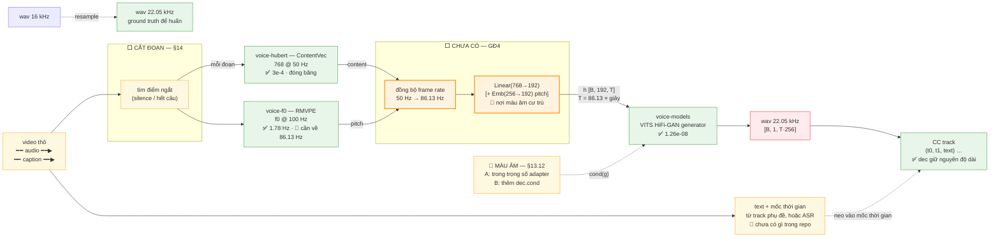
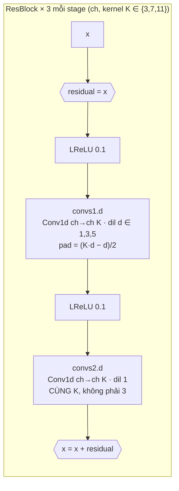

# voice-rs — Kiến trúc

Ghi chú kỹ thuật cho voice conversion viết bằng Rust + Burn.

**Runtime 100% Rust.** Trọng số và ground truth đã được export **một lần** rồi đóng
băng trên HuggingFace; repo **không có Python trong pipeline** (còn `scripts/screen_onnx.py`
là công cụ dev, chạy tay khi nạp một ONNX mới). Binary cuối cùng không cần Python.

> **Chỗ chưa chốt** được đánh dấu 🔶. Đó là những câu hỏi cần đo, không phải
> những chỗ còn suy nghĩ. Mọi thứ khác trong tài liệu này đã kiểm bằng số hoặc
> đọc source.

---

## 1. Hướng đi

### 1.1 Pipeline mục tiêu



**Đọc sơ đồ:**

| Màu / nét | Ý nghĩa |
|---|---|
| 🟩 xanh | đã xong, đã verify bằng số |
| 🟨 cam | ⬜ phần chưa có — GĐ4 |
| 🟨 vàng | 🔶 đã có tiền lệ / đã thiết kế, chưa chốt |
| 🟥 đỏ | kết quả |
| nét đứt `-.->` | không thuộc luồng inference — ground truth, hoặc đường chưa chốt |

⚠️ **Bốn điểm chưa giải quyết:**

| | Vấn đề | Mục |
|---|---|---|
| 1 | Ba tần số phải chạy về một: HuBERT **50 Hz**, RMVPE **100 Hz**, generator **86.13 Hz**. Adapter gánh cả đồng bộ frame rate *và* 768 → 192 | §13.2, §13.6 |
| 2 | **Màu âm** đi vào bằng cách nào — không dùng `g`, hay thêm `dec.cond` | §13.12 |
| 3 | **CC = closed caption**, chia theo dấu câu. Chưa có nguồn text nào trong repo; cách đặt mốc thời gian còn chưa chốt | §14.5 |
| 4 | 🔴 Sai số làm tròn frame **tích luỹ** khi cắt nhiều đoạn → caption trôi dần | §14.5 |


**Đã xong:** `voice-hubert`, `voice-f0`, `voice-mel`, `voice-models`,
GĐ1 (`derive(Module)`), GĐ2 (backward).
**Còn thiếu:** adapter (GĐ4) — mới là thứ chặn tiến trình; GĐ3 (`apply_lora` trên
`dec`) **đang bị chặn** vì burn chỉ LoRA cho tham số 2-D (§13.8.2); và toàn bộ phần
CC/caption (§14) chưa có gì.

**Bốn câu hỏi đang chặn — xem §15.**

**Huấn trong Rust, không cần PyTorch.** Burn 0.22 có sẵn `freeze`, `materialize`
và `Reparameterizer` tùy biến. ⚠️ Nhưng `apply_lora` **chỉ dùng được cho tham số
2-D**, còn generator toàn conv 3-D — đây là lý do GĐ3 bị chặn (§13.8.2). Đây là lý
do "Python chỉ để xuất trọng số" trở thành đúng nghĩa: toàn bộ huấn luyện cũng nằm
trong Rust.

### 1.2 Bốn model đã đo — quyết định dựa trên số

| Model | Nodes | `Expand` | Ngẫu nhiên lúc eval | AR / KV cache | Kết luận |
|---|---|---|---|---|---|
| RVC `SynthesizerTrn` (`use_f0=True`) | 3177 | **5** (shape `[0]`) | `randn` ở latent | không | burn-onnx panic |
| SpeechT5 VC decoder | 1471 | **5** | **`RandomUniformLike`** | **có** | không xuất được thành khối tĩnh |
| SpeechT5 HiFi-GAN (vocoder rời) | 205 | 0 | không | không | sạch, đã dựng xong — 🗑️ **sau đó bỏ**, xem §6.1 |
| **VITS `dec`** | **200** | **0** | không | không | **thắng** |

Chi tiết đo VITS `dec` (đúng `ljs_base.json`):

```
Conv 74 · LeakyRelu 69 · Add 44 · ConvTranspose 4 · Constant 4 · Div 4 · Tanh 1
FATAL: NONE        zero-sized init: NONE        14.33 M tham số
out [1, 1, T·256]  @ 22.05 kHz
```

### 1.3 Ba bài học từ hai lần đi sai

**1. Blocker cũ hẹp hơn ta tưởng, và ta chưa test đúng nhánh.** `Expand[0]` trong
RVC nằm trong `m_source` — bộ sinh sóng sin của NSF — và nó **chỉ tồn tại khi
`use_f0=True`**:

```python
# Applio: rvc/lib/algorithm/synthesizers.py:107-119
if use_f0:
    self.dec = HiFiGANNSFGenerator(..., sr=sr)    # có m_source → 3 Expand[0]
else:
    self.dec = HiFiGANGenerator(..., gin_channels=gin_channels)   # VITS thuần
```

Ta mất nhiều phiên xoay quanh `use_f0=True` mà **chưa bao giờ thử nhánh `False`**.

**2. Đo graph trước, code sau.** Mỗi lần đổi hướng đều lãng phí vòng lặp vì
export xong mới biết burn-onnx có lower được không. `scripts/screen_onnx.py` giải
quyết việc này (§7).

**3. `ort` không phải fallback miễn phí.** Nó chỉ đổi lỗi compile thành lỗi
runtime, đòi cài `libonnxruntime.dylib` (phá vỡ "100% Rust"), và **không** giải
quyết được `Expand[0]`. Đổi model rẻ hơn nhiều.

### 1.4 Checkpoint

```
sources/pretrained_ljs.pth     139 MB   VITS LJSpeech (MIT)
├── model          838 tensor, 36.32 M tham số
├── iteration      0
└── learning_rate  0.0002
```

`configs/ljs_base.json`:

| | |
|---|---|
| sampling rate / hop | 22050 / 256 → **86.13 Hz** |
| `hidden_channels` = `inter_channels` | 192 |
| `filter_channels`, `n_heads`, `n_layers` | 768, **2**, **6** |
| vocab (`add_blank`) | 178 |
| `resblock_kernel_sizes` / dilation | `[3, 7, 11]` / `[[1,3,5]] × 3` |
| `upsample_rates` / kernels | `[8,8,2,2]` / `[16,16,4,4]`, init **512** |
| `n_speakers` | **0** |

Trọng số lưu dạng **`weight_g` / `weight_v`** (weight-norm chưa decompose) →
`W = v · g / ‖v‖`, phải tính ở Python lúc xuất. **Chuẩn hoá trên mọi chiều TRỪ
chiều 0** (`dims = (1, …, −1)`), không phải "trừ chiều cuối" — xem bẫy 5 ở §2.3.

---

## 2. voice-models — VITS HiFi-GAN generator

Đã xong, viết tay bằng Burn. **Không** dùng burn-onnx codegen: kiến trúc chỉ là
conv, viết tay ~250 dòng, bỏ hẳn phụ thuộc `OUT_DIR` / `.bpk` / codegen.

Trong source VITS, class này tên là **`Generator`** (`models.py:244`), không
phải `HiFiGANGenerator` như trong RVC. Cần phân biệt để không tra nhầm khi đọc.

### 2.1 Cấu hình

| | |
|---|---|
| input | `z [B, 192, T]` |
| output | `wav [B, 1, T·256]` @ 22.05 kHz |
| tham số | **14.33 M** — **155 tensor** sau khi gộp weight-norm |
| `cond` | **không có** trong checkpoint (`n_speakers = 0`) |
| `m_source` (NSF) | **không có** — VITS gốc không có nhánh f0 nào cả |

Checkpoint có 231 tensor cho `dec`, nhưng 76 cặp `weight_g`/`weight_v` được gộp
thành 76 tensor `weight` → còn **155 file `.npy`**. `sources/vits_ljs_dec/` nặng 56 MB.

> **Điểm cần nhớ cho thiết kế adapter:** class `Generator` của VITS gốc **không
> có `emb_pitch`, không có `m_source`** — không một ô nào liên quan cao độ. Mọi
> thứ về pitch là thứ ta phải tự thêm. Xem §13.4.

### 2.2 Kiến trúc

```mermaid
flowchart LR
    Z["z [B,192,T]"] --> CPRE["conv_pre<br/>Conv1d 192→512 k7 p3"]
    CPRE --> ADD{{"x + COND(g)<br/>LJSpeech KHÔNG có<br/>đây là chỗ ta thêm"}}
    ADD --> L1["LReLU 0.1"] --> U0["ConvT1d<br/>512→256 k16 s8 p4"]
    U0 --> S0["Σ3 ResBlock (ch256 · k 3,7,11 · dil 1,3,5) / 3"]
    S0 --> L2["LReLU 0.1"] --> U1["ConvT1d 256→128 k16 s8 p4"]
    U1 --> S1["Σ3 ResBlock (ch128) / 3"]
    S1 --> L3["LReLU 0.1"] --> U2["ConvT1d 128→64 k4 s2 p1"]
    U2 --> S2["Σ3 ResBlock (ch64) / 3"]
    S2 --> L4["LReLU 0.1"] --> U3["ConvT1d 64→32 k4 s2 p1"]
    U3 --> S3["Σ3 ResBlock (ch32) / 3"]
    S3 --> LF["LReLU MẶC ĐỊNH<br/>slope = 0.01, KHÁC 0.1"]
    LF --> CPO["conv_post Conv1d 32→1 k7 p3<br/>bias = FALSE"]
    CPO --> TH["tanh"] --> W["wav [B,1,T·256]"]
```





Chi tiết `ups` và `resblocks` (`models.py:250-262`):

| | conv | stride | padding | ch sau |
|---|---|---|---|---|
| `ups[0]` | 512→256, k16 | 8 | 4 | 256 |
| `ups[1]` | 256→128, k16 | 8 | 4 | 128 |
| `ups[2]` | 128→64, k4 | 2 | 1 | 64 |
| `ups[3]` | 64→32, k4 | 2 | 1 | 32 |

`resblocks[i*3+j]` có `ch = 512/2^(i+1)` (256, 128, 64, 32),
`kernel = [3,7,11][j]`, `dilation = (1,3,5)`.

Padding lấy đúng từ source: `padding=(k-u)//2` → `[4, 4, 1, 1]`.

### 2.3 Bốn bẫy — đều xác nhận từ source, không phải suy luận

**1. LeakyReLU cuối khác slope.**

```python
# Applio hifigan.py:81   trong vòng lặp  -> LRELU_SLOPE = 0.1
x = F.leaky_relu(x, modules.LRELU_SLOPE)
# models.py:288           trước conv_post -> KHÔNG truyền slope -> default 0.01
x = F.leaky_relu(x)
```

Chi tiết kinh điển của VITS. Copy đè 0.1 là sai ngay.

**2. `convs2` dùng CÙNG `kernel_size`, không phải 3.**

```python
# Applio residuals.py:53
self.convs2 = self._create_convs(channels, kernel_size, [1]*len(dilations))
#                                          ^^^^^^^^^^ truyền lại kernel_size
```

Với `kernel_size = 11` thì `convs2` cũng là 11. (SpeechT5 thì dùng 3 — khác.)

**3. `conv_post` không bias.**

```python
# models.py:264
self.conv_post = Conv1d(ch, 1, 7, 1, padding=3, bias=False)
```

**4. Padding của ConvTranspose phải cho đúng chiều dài.**
Độ dài ra `(T−1)·u − 2p + k`; với `p = (k−u)/2` và `k = 2u` thì bằng đúng `T·u`.
Đúng bội trên giấy — nhưng **đã kiểm bằng thực nghiệm ở 7 giá trị `T`** (§2.5).

*(Bẫy thứ 5, ở script xuất chứ không ở kiến trúc: trọng số là `weight_g`/`weight_v`,
phải `W = v·g/‖v‖` ở Python.)*

### 2.3.1 ⚠️ Bẫy 5 — trục chuẩn hoá weight-norm (bug đã dính và đã sửa)

`torch.nn.utils.weight_norm` (mặc định `dim=0`) chuẩn hoá `v` trên **mọi chiều trừ
chiều 0**, rồi `g` có dạng `[out, 1, 1]` (đúng bằng norm keepdim). Bằng chứng trực
tiếp từ checkpoint: `dec.ups.0.weight_g` là `(512, 1, 1)` trên
`weight_v (512, 256, 16)`.

`scripts/export_vits_dec.py` bản đầu tính nhầm `dims = range(0, v.dim()-1)` =
"(mọi chiều trừ chiều cuối)". Với cả `Conv1d [out,in,k]` lẫn `ConvTranspose1d
[in,out,k]`, hai cách này khác nhau, và `g/norm` broadcast ra `[out,in]` → mỗi
phần tử `(out,in)` bị chia bởi norm của một kênh **khác**. Hậu quả:

| | RMS `dec(random N(0,1) z, T=250)` |
|---|---|
| trục SAI `dims=(0,1)` | **7.4e-4** (gần như câm) |
| trục ĐÚNG `dims=(1,…,−1)` | **2.16e-2** (mức tiếng nói) |

Bug này **không lộ** qua `verify_dec`: ground truth `ref_audio.npz` được sinh bởi
`build_reference()`, mà hàm đó dựng lại từ **chính các tensor đã xuất** — sai một
cách nhất quán thì hai bên vẫn khớp `3.3e-6`. Nó chỉ lộ khi đem adapter ra huấn
luyện: `dec` bị co biên độ ~30× nên `mel-L1` gần như phẳng, gradient tới adapter
~1e-7, loss không giảm. Sửa trục → loss giảm ngay (xem §13.6.2).

> **Bài học:** ground truth dựng từ artifact đã xuất chỉ kiểm được "hai bên khớp
> nhau", **không** kiểm được "artifact có đúng không". Muốn kiểm cái sau phải đối
> chiếu với **model gốc** (`net.dec(z)`), hoặc kiểm một tính chất vật lý (biên độ
> đầu ra phải ở mức tiếng nói).

### 2.4 Speaker conditioning — phần sẽ thêm

> ⚠️ **Ta thiếu cả BA món**, không chỉ `cond`. Checkpoint LJSpeech có
> `n_speakers = 0` nên không có `emb_g`, không có `dec.cond`, không có
> `flow.cond_layer`. Tài liệu cũ chỉ nói `cond` là thiếu.

VITS multi-speaker giải quyết *"đổi màu giọng"* bằng đúng cơ chế này:

```python
# models.py:266-273
if gin_channels != 0:
    self.cond = nn.Conv1d(gin_channels, upsample_initial_channel, 1)

def forward(self, x, g=None):
    x = self.conv_pre(x)
    if g is not None:
        x = x + self.cond(g)     # ← ngay sau conv_pre, CHỈ một chỗ
```

Flow cũng nhận `g`, mỗi layer một lát riêng (`modules.py:44,78-82`):

```python
self.cond_layer = weight_norm(Conv1d(gin_channels, 2*hidden*n_layers, 1))
...
g = self.cond_layer(g) if g is not None else None
```

Trong `dec`, `cond` chỉ là **một** `Conv1d` kernel 1. Về mặt toán học là một
linear map hạng ≤ `gin` cộng thẳng vào hidden stream — đúng nghĩa adapter hạng
thấp kiểu LoRA.

**Điều kiện để gập được (quan trọng):** gập chỉ đúng khi `g` là *một* vector cho
cả utterance. Khi đó `cond(g)` là **hằng số theo thời gian** và có thể cộng thẳng
vào bias của lớp → xuất ra **một generator thuần**, inference không tốn gì, ONNX
không có op lạ. Nếu sau này cần conditioning phụ thuộc thời gian (prefix-tuning,
FiLM) thì **không gập được**.

RVC/Applio dùng **y hệt** cơ chế này (`gin_channels = 256`,
`spk_embed_dim = 109`), chỉ khác là bọc thêm `weight_norm` quanh `cond_layer` —
và chính cái đó sinh ra node `WeightNorm` trong ONNX. **Ràng buộc cho ta: đừng
bọc weight-norm quanh adapter.**

Checkpoint LJSpeech có `n_speakers = 0` → không có sẵn để bật. Đó chính là lý do
hướng *"adapter trên model đã train sẵn"* đúng.

**Ba món đều phải tự thêm, và việc ta có cần tới không là câu hỏi riêng** — xem
§13.12. Với bài toán **1 người → 1 người**, hướng không dùng `g` (màu âm nằm trong
trọng số adapter, đúng kiểu RVC) là hướng rẻ nhất và không cần port `flow`.

### 2.5 Đã verify

`crates/voice-models/src/dec.rs` (~250 dòng, Burn tay) +
`crates/voice-models/src/npy.rs` (đọc `.npy`) +
`crates/voice-models/examples/verify_dec.rs`.

Cấu trúc Rust hiện tại:

```rust
struct ResBlock { convs1: Vec<Conv1d>, convs2: Vec<Conv1d> }
struct Generator { conv_pre: Conv1d, ups: Vec<ConvTranspose1d>,
                   resblocks: Vec<ResBlock>, conv_post: Conv1d,
                   n_kernels, lrelu_slope: f64, lrelu_slope_final: f64 }
```

> **GĐ1 xong (§13.10):** đã thêm `#[derive(Module)]`. `Vec<T>` **có** derive
> `Module` được (`burn-core/src/module/param/primitive.rs:133`) — tài liệu cũ ghi
> sai. Giữ `Vec`, đường dẫn record `ups.0.weight` khớp regex LoRA 76/76.
>
> Thêm hai hàm phục vụ kiểm chứng, không ảnh hưởng đường inference:
> `Generator::save()` (xuất `.bpk`) và `Generator::forward_trace()` (trả thêm đầu
> vào của `conv_post`).

**Layout weight khớp PyTorch y hệt — không cần transpose:**

| | PyTorch | burn 0.22 |
|---|---|---|
| `Conv1d` | `[out, in, k]` | `[channels_out, channels_in/groups, k]` ✅ |
| `ConvTranspose1d` | `[in, out/groups, k]` | `[channels_in, channels_out/groups, k]` ✅ |

**Một khác biệt API dễ sập:** `Conv1dConfig.padding` là `PaddingConfig1d`
(`Explicit(l, r)`), còn `ConvTranspose1dConfig.padding` là `usize` thuần.

Kết quả đo:

```
cargo run --release -p voice-models --bin verify_dec

    T     samples    mong doi  max abs diff          rms  ket qua
    1         256         256      7.392e-9     0.000738  PASS
    2         512         512      8.033e-9     0.000739  PASS
   10        2560        2560      1.048e-8     0.000739  PASS
   37        9472        9472      1.100e-8     0.000739  PASS
  100       25600       25600      1.094e-8     0.000739  PASS
  137       35072       35072      1.263e-8     0.000739  PASS
  250       64000       64000      1.182e-8     0.000739  PASS

max abs diff lớn nhất: 1.263e-8        PASS tat ca
```

Tốt hơn dự đoán `1e-4` hai bậc độ lực. Lý do: burn-flex và PyTorch cùng tích luỹ
`f32` theo cùng thứ tự phép nhân, chênh lệch chỉ ở vài ulp.

### 2.6 Hai lỗi thật mà quy trình verify bắt được

Cả hai đều là lỗi **của tôi**, không phải của framework — nhưng không có bước
verify thì cả hai sẽ lọt vào bản *"chạy được"*.

**1. Padding của `convs2`.** Tôi viết `PaddingConfig1d::Explicit(k-1, k-1)`. Đúng
phải là `(k-1)/2` (vì `pad = (k·d − d)/2`, `d = 1`). Sai thì chiều dài phình ra mỗi
conv, và burn báo:

```
Incompatible size at dimension '2' => '10 != 8'
[1, 256, 10] vs [1, 256, 8]
```

Chênh đúng 2 = `k-1` với `k = 3`.

**2. Shape kỳ vọng của `ups`.** Tôi viết kiểm tra `(out, in, k)` nhưng
`ConvTranspose1d` lưu weight theo `[in, out, k]` — ngược với `Conv1d`. Kiểm tra
cấu trúc trong `export_vits_dec.py` bắt được ngay:

```
x ups.0.weight (512, 256, 16) != (256, 512, 16)
```

Đây chính là giá trị của việc **kiểm tra shape trước khi viết forward**: lỗi 2 lộ
ra ở tầng xuất, chỉ tốn vài giây; nếu chờ tới forward thì phải debug từ đầu.

---

## 3. voice-mel — Mel spectrogram

**Trạng thái:** ✅ khớp `torch.stft` và HF `SpeechT5FeatureExtractor`

### Ba biến thể

| | `rmvpe()` | `rvc()` | **`speecht5()`** |
|---|---|---|---|
| mel scale | HTK | Slaney | **Slaney** |
| norm | None | Slaney | **Slaney** |
| n_mels | 128 | 128 | **80** |
| n_fft | 1024 | 1024 | **1024** (win 64 ms) |
| hop | 160 (100 Hz) | 160 | **256 (62.5 Hz)** |
| fmin / fmax | 30 / 8000 | 0 / 8000 | **80 / 7600** |
| padding | reflect | (n_fft−hop)/2 = 432 | **reflect (center=true)** |
| floor | 1e-5 | 1e-5 | **1e-10** |
| log | ln | ln | **log10** |
| dùng cho | RMVPE (F0) | loss khi huấn | **SpeechT5 HiFi-GAN** |

### Ba điểm dễ sai nhất

1. **log10, không phải ln.** HF `SpeechT5FeatureExtractor` dùng `log_mel="log10"`.
   `rosa` đã có `mel_filter()` + `MelNorm::Slaney` nên khỏi viết lại filterbank.
2. **Floor trước log.** HF làm `np.maximum(1e-10, mel)` rồi mới `log10`.
3. **Slaney mel + Slaney norm**, không phải HTK.

> `rosa::MelNorm` không derive `Copy`, nên `MelConfig` cũng bỏ `Copy` (cần
> `self.norm.clone()` trong `filterbank()`).

### Ghi chú: `rosa` dùng power=2

`rosa` theo librosa, mặc định `power = 2` (magnitude²). Cả hai hệ mel ở trên dùng
**amplitude** (căn bậc hai) → phải tự tính: `stft_as_real_imag` →
`sqrt(re²+im²)` → matmul filterbank → `max(floor, ·)` → log.

### Verify

```
cargo run --release -p voice-mel --example verify_speecht5
→ [80, 428] cả hai bên,  max abs diff 4.768e-07   PASS

RMVPE/RVC: 3487 frame khớp pitch_fine.npy, max abs diff 4e-4 vs torch.stft
```

---

## 4. voice-hubert — ContentVec embedder

**Trạng thái:** ✅ max abs diff `3e-4` vs `contentvec/feats.npy`

```
Repo:      IAHispano/Applio → Resources/embedders/contentvec
Arch:      HubertModelWithFinalProj (hidden 768, 12 layers, 12 heads)
ONNX:      sources/contentvec/contentvec_768l12.onnx
Output:    [1, T, 768],  T = (len − 80) / 320  →  50 Hz @ 16 kHz
```

Preprocessing (Applio `create_reference.py`): peak-normalize → trim bội 320 →
pad reflect 40 mỗi bên. **Không có z-score** dù `preprocessor_config.json` ghi
`do_normalize: true`; GroupNorm trong model tự hấp thụ scale/offset.

**HuBERT là 16 kHz, hop 320 → 50 Hz native.** Không resample, không upsample.

ContentVec ở bản v1 có thêm `final_proj` 256-dim; bản **v2 không có**, output
768-d thẳng (`pipeline.py:332` chỉ gọi `final_proj` khi `version == "v1"`). Ta
dùng bản 768 → **không cần `final_proj`**, khớp `Linear(768→192)` của RVC v2.

Ghi chú: build script gen `.bpk` vào `OUT_DIR` — phải đọc `env!("OUT_DIR")`, **không**
đọc `sources/`. Thiếu file thì `Err`, không fallback random (§8.1).

---

## 5. voice-f0 — RMVPE

**Trạng thái:** ✅ mean diff `1.78 Hz` vs `pitch_fine.npy`

🔶 **Trước đây nằm ngoài đường inference. Nay có thể vào** — nếu chọn phương án
có pitch ở §13.4. RMVPE đã ổn định, giữ lại không tốn gì.

```
mel [128, T] @100 Hz → reflect-pad bội 32 → RMVPE (BiGRU 3 tầng, 256)
→ [1,360,T] → decode → f0_fine → coarsen → f0_coarse
```

**RMVPE là 100 Hz native** (16 kHz, hop 160), khác HuBERT (50 Hz) — đây là lý do
RVC upsample content ×2 (§13.2). Ta sẽ phải đưa **cả hai** về 86.13 Hz.

Giải mã phải theo **code**, không theo paper: `threshold = 0.03` (không phải 0.5),
cửa sổ ±4 quanh argmax, `cents_mapping = 20·arange(360) + 1997.3794`, và
`f0 == 10 → 0 Hz`.

---

## 6. Các crate

**6 crate**, sau khi gom (xem "dọn dẹp" bên dưới):

| Crate | Trách nhiệm | Trạng thái |
|---|---|---|
| `voice-hubert` | ContentVec 768 @ 50 Hz | ✅ xong, chờ adapter |
| `voice-mel` | log-mel (nhiều variant) | ✅ verify `4.77e-07` |
| `voice-f0` | RMVPE, f0 @ 100 Hz | ✅ xong, 🔶 chờ chốt §13.4 |
| `voice-models` | **VITS HiFi-GAN generator** (`dec`), viết tay | ✅ verify `1.26e-08` |
| `voice-lib` | **Thư viện dùng chung**: `cc` (tách dấu câu, chia frame, `.srt`) + `vc` (`Adapter` Burn P1, nội suy frame rate, resample PCM) | 🟡 logic + `Adapter` xong (**43 unit test**) |
| `voice-train` | **Huấn luyện + validate**: log-mel khả vi bằng Burn (`burn::signal::stft`), loss `L1`, vòng overfit adapter | 🟡 `examples/train_adapter` chạy được, loss giảm — §13.6.2 |

`voice-lib` là mục đích cho **bên ngoài** dùng; **training + validate** nằm ở
`voice-train` — `voice-lib` không được phụ thuộc `sources/` hay build
script, và **không** kéo phụ thuộc huấn luyện.

Phân tách từng tầng cho phép verify độc lập với PyTorch — điều đã cứu ta ở §3,
§4, §5.

### 6.1 🗑️ Đã dọn (gom crate)

| Xoá | Kích thước | Vì sao |
|---|---|---|
| `voice-models/src/model.rs` | **13 065 dòng** | burn-onnx codegen SpeechT5 HiFi-GAN — đường cũ |
| `voice-models` `HiFiGan`/`VocoderError` + `build.rs` + `examples/vocoder.rs` | ~270 dòng | chỉ dùng cho đường cũ |
| `voice-pipe` | 92 dòng | chỉ bọc `HiFiGan`, không ai dùng |
| `voice-index` | 247 dòng | FAISS/RVC, VITS không có retrieval |
| `voice-cc` + `voice-vc` | 2 crate | gộp vào `voice-lib` |

Tổng: **8 crate → 5**, bỏ ~13,7k dòng chết. Hệ quả phụ đắt giá: `voice-models`
**không còn cần** `sources/vocoder/generator.onnx` để build.

> `MelConfig::speecht5()` + `verify_speecht5` **giữ lại** ở `voice-mel` — chúng là
> anchor đo lường (đối chiếu `SpeechT5FeatureExtractor`), không kéo runtime cũ.

---

## 7. Quy trình chọn & sàng lọc model

```bash
python3 scripts/screen_onnx.py <model.onnx>
```

In opset, histogram op, rồi 4 cờ đỏ. Chạy **trước** khi export/import.

Thứ tự ưu tiên khi chọn model:

1. **Đếm node + opset.** `Conv`/`ConvTranspose`/`LeakyRelu`/`Add`/`Sub`/`Div`/
   `Tanh`/`Transpose`/`Squeeze` là an toàn tuyệt đối.
2. **`Expand` = chặn đứng.** burn-onnx sinh `.expand([...])`; burn từ chối mọi giá
   trị `0` hoặc `-1` vì đó là sentinel broadcast.
3. **Initializer mang size 0** → cũng dẫn tới `.expand([0])`.
4. **Weight-norm remnants** → phải decompose trước khi xuất.
5. **Ít dynamic dim** — lý tưởng chỉ 1 (trục thời gian).
6. **Ưu tiên model tách rời** (vocoder rời) hơn model gộp nhiều module.
   200 node vs 3177 node là khác biệt giữa một buổi chiều và nhiều ngày.
7. **Kiểm tra có AR / KV cache không** — đây là lý do SpeechT5 VC bị lo dù opset
   không quá xấu.
8. Pass cả 7 mới làm. Không pass thì **đổi model**, đừng vá ONNX.

### Một hiệu chỉnh: `ConstantOfShape` không phải op chặn

Bản đầu của `screen_onnx.py` xếp `ConstantOfShape` vào danh sách chặn — **sai**.
Chạy thử trên `rmvpe_f0.onnx` cho thấy RMVPE có `ConstantOfShape` mà vẫn import và
chạy tốt từ trước:

```
rmvpe_f0.onnx:   ConstantOfShape 1,   Expand 0   → OK
```

Chỉ khi output của nó đổ vào `Expand` thì mới chết. Script đã tách `FATAL`
(chặn) và `INFO` (chỉ báo).

Đã kiểm detector không rỗng: ONNX nhân tạo gồm `ConstantOfShape([0]) → Expand`
trả `KHONG AN TOAN`, exit code 1; hai model thật đều trả `OK`.

### Vá ONNX hậu kỳ — không phải chiến lược

4 lần thử đều hỏng (topological sort, SSA form). Và ngay cả khi vá được, burn-onnx
đã **bake shape runtime vào constant** (`shape6_out1 = [6i64]`), nên code
generated **sai số** cho mọi `T` khác giá trị trace. Vá chỉ là trì hoãn — sửa ở
Python hoặc đổi model.

---

## 8. Bốn bẫy đã vấp

### 8.1 Fallback random weights → NaN

Build script gen `.bpk` vào `OUT_DIR`; code ban đầu đọc `sources/.../model.bpk` —
không tồn tại. Fallback gọi `Model::new()` → **random init** → NaN.

**Fix:** đọc `env!("OUT_DIR")`, thiếu file thì `Err` — không fallback.

### 8.2 `f32::max(NaN) == 0.0` → test báo ✅ giả

```rust
max_diff = max_diff.max(NaN);   // luôn giữ 0.0
if max_diff < 1e-3 { /* in ✅ */ }
```

**Fix:** check `is_finite()` trước khi so số. Cũng áp dụng cho GĐ2 (gradient).

### 8.3 `optimum-cli` không có `--subfolder`

`optimum-cli export onnx --model IAHispano/Applio ...` không chỉ đúng subfolder →
export ra HuBERT-Large (1024/24) thay vì ContentVec (768/12). Shape vẫn *"khớp"*
vì cùng kiến trúc → rất dễ bỏ qua.

**Cách đúng:** tải từ HF bằng `snapshot_download(allow_patterns=...)` rồi export từ
local path, và **verify config** trước (`hidden_size: 768`,
`num_hidden_layers: 12`, `HubertModelWithFinalProj`).

### 8.4 STFT padding: `rosa` zero-pad vs `torch.stft` reflect-pad

Tốn nhiều thời gian nhất trong 4 bẫy. `rosa` theo librosa: `center=true` →
**zero-pad**; `torch.stft` mặc định reflect-pad → 6 frame đầu sai → U-Net lan ra
~24 frame → F0 lệch toàn bộ.

**Fix:** tự pad reflect thủ công rồi gọi `rosa` với `center=false`.

---

## 9. Trạng thái & lệnh chạy thử

| Hạng mục | Trạng thái |
|---|---|
| `voice-hubert` | ✅ max abs diff `3e-4` |
| `voice-mel` | ✅ max abs diff `4.77e-07` |
| `voice-f0` | ✅ mean diff `1.78 Hz` |
| `voice-models` (VITS `dec`, viết tay) | ✅ **max abs diff `1.26e-08`** trên 7 giá trị T |
| ~~`voice-models` (SpeechT5 HiFi-GAN)~~ | 🗑️ **đã xoá** — đường cũ, kéo theo `model.rs` 13 065 dòng (§6) |
| `dec.rs` → `#[derive(Module)]` | ✅ GĐ1 — `verify_dec` vẫn `1.26e-08` |
| backward trên `Autodiff<Flex>` | ✅ GĐ2 — 6/6 gradient ≠ 0, finite; khớp tay `5.8e-09` |
| `ParamGroup` + regex chọn block | ✅ khớp **76/76** tensor |
| `freeze()` base | ✅ có hiệu lực thật (chạy backward xác nhận) |
| `apply_lora` trên `dec` | 🔴 **GĐ3 BLOCKED** — burn chỉ LoRA cho tham số **2-D** (§13.8.2) |
| `materialize()` | 🟡 sẵn sàng, nhưng chưa có adapter để gộp |
| chốt pitch/NSF · P1/P2/P3 · LoRA hay không | 🔶 §13.4 · §13.6 · §13.8.2.5 — **cần quyết** |
| màu âm (speaker) | 🔶 1→1 → hướng **A** (không `g`, y hệt RVC) hoặc **B** (`dec.cond`) — §13.12 |
| **audio người nói đích** | 🔴 **chỉ 1 file, 6.84 s** — kẹt GĐ4, không giải quyết bằng code (§13.12.3) |
| chia đoạn theo dấu câu | ✅ **chia theo dấu câu đã hiện thực** (`voice-lib/cc`, 12 unit test) · 🔶 research còn 1 câu (d) — §14.5 |
| CC track `(t0, t1, text)` | 🔴 **chưa có gì cả** — không có video, không có ASR, không có forced alignment — §14.1 |
| sai số làm tròn frame tích luỹ | ✅ **đã xử lý** — `voice-lib/cc::split_frames` (largest-remainder, 10 test) · 🔴 chưa nối vào pipeline — §14.4 |
| receptive field của `dec` | 🟡 **5.93 s** tính tay · 🔴 **chưa đo thực nghiệm** — §14.6 |
| adapter HuBERT → latent (50 → 86.13 Hz) | ✅ **`Adapter` Burn P1 xong** (`voice-lib/vc`, 3 test) + resample PCM 16k→22.05k (6 test) · ✅ **`voice-train` xong** — overfit giảm loss `2.22×`/40 bước — §13.6.2 |
| features HuBERT của audio đích | ✅ **đã xuất** `sources/features/422-122949-0031.npy` `[1,342,768]` (`embed <wav> <out.npy>`) |
| ~~`voice-index`~~ | 🗑️ **đã xoá** — FAISS/RVC, không dùng |

```bash
# ===== VITS: nạp trọng số (đã đóng băng trên HF) rồi verify =====
./scripts/fetch_assets.sh                                # contentvec + vits_ljs_dec từ HF
cargo run --release -p voice-models --bin verify_dec     # forward vs PyTorch
cargo run --release -p voice-models --example verify_backward # GĐ2: gradient
cargo run --release -p voice-models --example verify_lora     # GĐ3: BLOCKED, xem §13.8.2

# Kiểm tra sàng lọc trước khi làm bất cứ thứ gì (công cụ dev, chỉ khi nạp ONNX mới)
python3 scripts/screen_onnx.py <model.onnx>

# Anchor đo lường mel (ref_mel.npy là ground truth đã đóng băng, không còn runtime)
cargo run --release -p voice-mel --example verify_speecht5

# Các tầng đã xong
cargo run --release -p voice-hubert --bin embed -- <wav>                # verify
cargo run --release -p voice-hubert --bin embed -- <wav> <out.npy>      # + ghi features [1,T,768]
cargo run --release -p voice-f0    --example f0_extract -- <wav>            # verify

# Huấn luyện adapter (GĐ4) — cần sources/vits_ljs_dec + features + wav, xem §13.6.2
cargo run --release -p voice-train --bin train_adapter                  # cả câu
SEG=86 STEPS=40 cargo run --release -p voice-train --bin train_adapter  # smoke 1 s

cargo build --workspace
cargo test -p voice-lib -p voice-mel -p voice-train
```

---

## 10. Ground truth & disk

```
sources/
├── pretrained_ljs.pth      139 M   VITS LJSpeech checkpoint gốc (lưu trữ local; KHÔNG còn trong pipeline — dec đã export sẵn)
├── vits_ljs_dec/            56 M   155 tensor .npy + config + ground truth
├── features/                        HuBERT features đã xuất (audio đích) — §13.6.1
├── vits/                            mã nguồn VITS gốc (tham chiếu)
├── Applio/                    54 M   mã nguồn RVC (tham chiếu)
├── burn/                            mã nguồn Burn 0.22 (tra LoRA/freeze)
├── contentvec/               360 M   ContentVec-768 ONNX (HuBERT của Facebook)
├── rmvpe_f0.onnx             345 M   RMVPE ONNX (cho voice-f0)
├── 422-122949-0031.wav       428 K   wav test chính (float32, 16 kHz)
├── ref_mel.npy                       ground truth SpeechT5
└── Applio/logs/reference/    ground truth RVC (contentvec/feats.npy, pitch_*.npy)
```

Các file model (`contentvec/`, `rmvpe_f0.onnx`, `vits_ljs_dec/`)
**pull từ ngoài** theo `scripts/asset_checksums.txt` — xem §16.2.

Ground truth cho `dec`:

| | |
|---|---|
| `vits_ljs_dec/ref_input.npz` | `z` cho 7 giá trị `T` ∈ {1, 2, 10, 37, 100, 137, 250} |
| `vits_ljs_dec/ref_audio.npz` | wav tương ứng từ PyTorch |
| `vits_ljs_dec/dec/*.npy` | 155 tensor trọng số (weight-norm đã gộp) |
| `vits_ljs_dec/config.json` | cấu hình kiến trúc |

> WAV test là **float32** (`wFormatTag = 3`), không phải PCM16. `bits` nằm ở
> `fmt[7]`, block align ở `fmt[6]` — đọc sai là sinh toàn `-10`.

`sources/` nằm trong `.gitignore` — chỉ **code** vào repo. Model và ground truth
phải regenerate bằng script.

### Prebuilt assets đã khảo sát

| Repo HF | File | Ghi chú |
|---|---|---|
| `TigreGotico/voiceclonnx-rvc` | `contentvec_768l12.onnx` fp32 / `_q8` | **có parity report** `max_abs 8.5e-06` |
| `TigreGotico/voiceclonnx-rvc` | `rmvpe.onnx` fp32 / `_q8` | có provenance |
| `ohnoitsaninja/rvc-base-onnx` | `rmvpe.onnx`, `hubert_base_layer12_32000.onnx` | có SHA256SUMS |
| `IAHispano/Applio` | `predictors/swift.onnx` 135 KB | pitch estimator khác |

Bản khác export chưa chắc đã sạch op — vẫn phải chạy `screen_onnx.py` (§7).

---

## 11. Ghi chú kỹ thuật

- `rosa = "=0.1.0"` — pin cứng, crate mới, API có thể đổi.
- Burn 0.22: `Backend` **không** là type parameter, và `Tensor` cũng **không** có
  (`burn-tensor/src/tensor/api/base.rs:76`): `pub struct Tensor<const D: usize, K = Float>`.
  Backend được chọn lúc chạy từ `Device` → `Device::default()` vs
  `Device::default().autodiff()`. `Device` không generic.
- Bật autodiff: thêm feature `"autodiff"` vào `burn` trong workspace `Cargo.toml`.
  `Tensor::backward()` **panic** nếu thiếu, với thông báo rõ ràng.
- API record của burn 0.22: `into_record`, `load_record`, `try_load_record`,
  `save_file`, `try_load_file`. **Không còn** `from_record` — nạp *vào* một module
  đã khởi tạo.
- Đọc gradient: `param.grad_remove(&mut grads)` (chỉ lấy được **một** lần),
  `tensor.grad(&grads)` nếu cần giữ lại. `Param` deref sang `Tensor`.
- `Conv1d` / `ConvTranspose1d` nằm ở `burn::nn::conv::*`, **không** phải
  `burn::nn::*`.
- burn-onnx gen tên module theo tên file ONNX: `generator.onnx` →
  `generator.rs` → `pub mod generator_model`.
- `voice-models` cần `burn-store` ở cả `[dependencies]` lẫn `[build-dependencies]`.
- burn-onnx sinh sẵn `impl Default` với **đường dẫn tuyệt đối** của lần build đó →
  stale khi rebuild. Nên tự gọi `Model::from_file(&bpk, &device)`.
- `torch.nn.utils.remove_weight_norm` **không** dùng được với module tạo bằng
  `parametrizations.weight_norm` (lỗi `weight_norm of 'weight' not found`). Phải
  dùng `torch.nn.utils.parametrize.remove_parametrizations(m, "weight")`.
- Checkpoint VITS cũ dùng `weight_g`/`weight_v` → `W = g · v / ‖v‖`.

---

## 12. Các script đi kèm

| Script | Vai trò |
|---|---|
| `scripts/screen_onnx.py` | sàng lọc ONNX trước khi import (§7) — **công cụ dev**, chỉ chạy tay khi nạp một ONNX mới |
| ~~`scripts/export_vits_dec.py`~~ | 🗑️ đã xoá — trọng số `dec` đã export MỘT LẦN rồi đóng băng trên HF (§16.2) |
| ~~`scripts/ref_mel.py`~~ | 🗑️ đã xoá — `sources/ref_mel.npy` là ground truth đã đóng băng |
| ~~`scripts/check_ref_mel.py`~~ | 🗑️ đã xoá — chỉ dùng để kiểm chứng `ref_mel.py` một lần |
| ~~`scripts/export_vocoder.py`~~ | 🗑️ đã xoá — chỉ phục vụ vocoder SpeechT5 đã bỏ (§6.1) |

---

## 13. Kiến trúc đích

### 13.1 Vì sao vẫn là VITS

Đã chốt ở §1.2: 200 node, 0 `Expand`, 0 ngẫu nhiên lúc eval, 14.33 M tham số,
không AR. `dec` đã verify `1.26e-08` trên 7 giá trị `T`. Phần còn lại là **xây
adapter bên trên**, không phải đổi model.

### 13.2 ⚠️ Hai tầng upsampling — và vì sao ta không thoát

Có **hai** tầng nâng mẫu khác nhau, thường bị gộp làm một:

| | RVC | VITS LJSpeech |
|---|---|---|
| **Tầng 1** — trước generator, đồng bộ frame rate | HuBERT 50 → 100 Hz | HuBERT 50 → **86.13 Hz** |
| **Tầng 2** — trong generator, lên raw waveform | ×400 → 40 kHz | ×256 → 22.05 kHz |
| Tổng: 1 s âm thanh → | 40 000 mẫu | 22 050 mẫu |

**Tầng 2 không đổi được.** Generator là bộ upsampling cố định ×256, không có tham
số nào để đổi (`upsample_rates=[8,8,2,2]` nằm thẳng trong trọng số):

```
T_latent = 22050 / 256 = 86.13 frame/giây     ← bắt buộc
```

**Ví dụ — 1 giây âm thanh đưa thẳng 50 frame vào `dec`:**

| | T | output | thời lượng |
|---|---|---|---|
| vào | HuBERT 50 Hz | — | 1.000 s |
| đưa thẳng vào `dec` | 50 | 50×256 = **12 800** mẫu | **0.581 s** |

Nghe ra nhanh hơn và cao hơn **1.72×**. Không dùng được.

**RVC thoát được vì tỉ lệ của họ là số nguyên** — `pipeline.py:343-345`:

```python
# feature upsampling
feats = F.interpolate(feats.permute(0, 2, 1), scale_factor=2).permute(0, 2, 1)
```

Không truyền `mode` → mặc định **`'nearest'`**. Với `scale_factor=2` nguyên thì
nearest **tương đương `repeat_interleave(2)`** về mặt số học — nhân đôi từng
frame. Không có tham số học được ở đây.

> Chi tiết dễ nhầm: `repeat_interleave` **không xuất hiện** trong Applio
> (`grep` ra 0 kết). Và `mode="linear"` chỉ xuất hiện ở `pipeline.py:67,72` cho
> **RMS** (volume-match) và `refinegan.py:390` cho **f0** — không phải content.

**Vì sao RVC upsample đúng ×2** (`pipeline.py:471-475`):

```python
pitch, pitchf = pitch[:p_len], pitchf[:p_len]   # ← CHỈ CẮT, không nội suy
```

Pitch **không** cần nội suy vì RMVPE chạy hop 160 @16 kHz = **100 Hz native**.
Nên ×2 là để khớp **cả hai** đích cùng lúc:

| | tần số |
|---|---|
| HuBERT | 50 Hz |
| **RMVPE f0** | **100 Hz** ← native |
| **latent VITS** | **100 Hz** (hop 400 @ 40 kHz) |

Tỉ lệ đúng là 2 **vì RMVPE và latent trùng nhau ở 100 Hz**. Đó là may mắn của
RVC, không phải thiết kế có chủ đích.

Ta thì có f0 (nên vẫn phải đưa **cả hai** về 86.13 Hz) nhưng **tỉ lệ 1.7226 là
bắt buộc** — không có checkpoint VITS nào có `product × 50 = 22050`.

Bốn lối, nhưng chỉ **hai** còn dùng được:

| | Cách | Đánh giá |
|---|---|---|
| **(a)** | Nội suy `nearest` 50 → 86.13, y hệt RVC | baseline rẻ, vài dòng. RVC **và RMVPE** đều chứng minh model chịu được frame lặp — xem §13.2.1 |
| **(b)** | **Bộ lấy mẫu phân đoạn học được** — *không phải* `ConvTranspose1d` | offset `p = t / 1.7226`, trọng số học trên cửa sổ quanh `p`, sinh **đúng** `T` frame → khớp §14.4 |
| ~~(c)~~ | ~~Adapter học lên bằng `ConvTranspose1d`~~ | ❌ **stride là số nguyên** → `1.7226` không diễn tả được bằng một tầng upsample conv |
| **(d)** | Đổi checkpoint cần `product = 441` | không tồn tại |

**Baseline nên là (a)**, rồi thay bằng (b) và so kết quả.

Và trả lời *"vì sao phải làm"*:

> Adapter HuBERT → latent **đã phải tồn tại rồi**, vì 768 ≠ 192. Nó không tạo
> thêm việc gì. Việc đưa 50 Hz lên 86.13 Hz **chính là nhiệm vụ đầu tiên của
> adapter** — (a) chỉ là trường hợp riêng của (b) khi dùng nội suy cố định làm
> tầng đầu.

Các lối thoát khác cũng không dùng được: dán nhãn output là 12.8 kHz thay vì
22.05 kHz thì nghe sai; chạy HuBERT ở 22.05 kHz với hop 320 ra 68.9 Hz — vẫn
không khớp, mà HuBERT lại bị hỏng khi vào audio sai tần số.

> ⚠️ **Đính chính (tự sửa sau khi đọc lại tài liệu gốc).** Bảng này trước đây ghi
> **(b) = `ConvTranspose1d`** và coi đó là "adapter tự học nhịp". Sai ở chỗ:
> stride của `ConvTranspose` là **số nguyên**, nên `50 → 86.13` (tỉ lệ **1.7226**)
> không biểu diễn được trực tiếp. Ba mục dưới đây giải thích vì sao hướng đúng là
> **nội suy có tham số học**, không phải upsample conv.

#### 13.2.1 Vì sao *trong* mạng là Conv, *ngoài* mạng là nội suy

Hai tầng ở bảng đầu §13.2 không chỉ khác về tỉ lệ — chúng khác về **bản chất**:

| | Input | Có muốn *học* cách điền? | Đúng phải dùng |
|---|---|---|---|
| Tầng 2 — `dec` ×256 | latent **đã học** | ✅ có — phải bịa ra mẫu chưa hề tồn tại | `ConvTranspose` |
| Tầng 1 — đồng bộ frame rate | HuBERT **đo được** | ❌ không — chỉ đổi nhịp lấy mẫu | nội suy |

Đây không phải suy đoán. **RMVPE dùng cả hai**, và tách bạch rõ ràng:

| | VITS | RMVPE |
|---|---|---|
| Trong graph | `ConvTranspose` ×4, `k = 2s` | `ConvTranspose` ×5, `k=3, s=2` → ×32 |
| Ngoài graph | — | `F.interpolate(mode="nearest")` |

Đo từ `sources/rmvpe_f0.onnx`:

```
ConvTranspose ×5, tất cả: k=3  stride=2  pad=1     → ×32    (100 Hz → 3200 Hz)
```

Toàn bộ op của graph:

```
Transpose, Unsqueeze, BatchNormalization, Conv, Relu, Add, Pad,
AveragePool, ConvTranspose, Concat, Shape, Constant, Slice, Reshape,
Gather, ConstantOfShape, GRU, MatMul, Sigmoid
                    ↑ KHÔNG có Interp / Resize / Upsample
```

Mà 3200 Hz không phải thứ ai cần. Việc đưa về 100 Hz nằm ở
`sources/Applio/rvc/lib/predictors/FCPE.py:860-873`:

```python
def interp_method(content, target_len, mode: str = "nearest"):
    ...
    results = torch.nn.functional.interpolate(content, size=target_len, mode=mode)
```

**Quy tắc rút ra:**

| | Dùng gì | Vì sao |
|---|---|---|
| **Bên trong mạng** | `ConvTranspose` | muốn **học** cách điền khoảng trống |
| **Bên ngoài mạng** | `F.interpolate` | tỉ lệ cố định, không có gì để học |

Tầng 1 của ta (50 → 86.13) thuộc loại thứ hai. Vì vậy (a) hợp lệ, và (b) nếu muốn
tốt hơn (a) thì phải là *nội suy có trọng số học được*, không phải upsample conv.

**✅ Đã hiện thực tầng 1 (option (a)):** `crate voice-lib` (`src/vc/resample.rs`) —
`nearest_index_map(t_in, t_out) = floor(t · t_in / t_out)`, 8 unit test. Không có
tham số, khớp `F.interpolate(mode="nearest")` khi tỉ lệ nguyên (×2 → `[0,0,1,1,…]`),
và **không bỏ sót** source frame nào khi `t_out ≥ t_in`.

#### 13.2.2 burn thực sự làm gì: GEMM + col2im, **cộng dồn**

`sources/burn/crates/burn-flex/src/ops/conv_transpose.rs:8-10`:

> For each (batch, group), computes: `columns = W_g^T @ X_g`, then scatters the
> columns matrix into the output via **col2im**.

Và dòng quyết định — `:454-455`:

```rust
channel_output[out_idx] = T::add(channel_output[out_idx], val);   // ← CỘNG, không gán
```

Đây là **overlap-add**. Chi tiết này quan trọng vì ba lý do:

**(1) `ConvTranspose` KHÔNG phải "conv nghịch đảo".** Không có ma trận nghịch đảo
nào được tính (việc đó sẽ cần giải một hệ tuyến tính). Nó làm đúng ba bước:

```
mỗi input sample i  →  đẩy vào k vị trí output: i·s + k′ − p
nếu hai input chiếu vào cùng một vị trí  →  CỘNG
```

**(2) Vì sao Conv chứ không nội suy.** Nội suy có **0 tham số**:

| | Nội suy `nearest` | `ConvTranspose` |
|---|---|---|
| Tham số | **0** | `k × C_in × C_out` — học được |
| Mỗi mẫu output | **chép** 1 mẫu vào | tổng có trọng số của ~2 mẫu lân cận |
| Giữa hai frame | bậc thang (piecewise-constant) | trơn, có ngữ cảnh |

Với `ups[0]` của ta — shape `[256, 512, 16]`, stride 8 — mỗi mẫu output là tổng của
**8 192 tham số** quyết định cách điền khoảng trống giữa hai frame. Nội suy không thể
tạo ra thứ chưa từng có trong input.

**(3) Không cần materialize tensor nhồi zero.** Cách "nhồi zero rồi conv" cho ra
**đúng kết quả toán học** nhưng tốn bộ nhớ; burn làm thẳng bằng GEMM (phần nặng) +
col2im (phần tán xạ nhẹ).

#### 13.2.3 VITS chọn `k = 2s` **cố ý** — và ta phụ thuộc vào điều đó

```
upsample_rates  = [8, 8, 2, 2]
upsample_kernels= [16, 16, 4, 4]      ← k = 2s ở CẢ 4 tầng
```

Hai hệ quả, cả hai đều là thứ `dec.rs` đang dựa vào:

**Hệ quả 1 — chiều dài ra tuyệt đối, không lệch một mẫu:**

```
p       = (k − s)/2 = s/2
out_len = (T−1)·s − 2p + k
        = (T−1)·s − s + 2s
        = T·s                              ← không dư không thiếu
```

Đây chính là điều **bẫy số 4** (§2.3) cảnh báo phải kiểm thực nghiệm — và ở ta nó
đúng trên cả 7 giá trị `T` đã thử.

**Hệ quả 2 — mỗi mẫu output là trung bình có trọng số của **2** input, trừ hai đầu:**

```
o = i·s + k′ − s/2
⇒ k′ ≡ o + s/2  (mod s),   k′ ∈ [0, 2s)
⇒ đúng 2 giá trị k′ thỏa mãn
```

Nhưng "2 giá trị `k′`" **không** luôn có nghĩa là 2 input *hợp lệ* — ở sát biên,
một trong hai rơi ra ngoài `[0, T)`. Đo thật (`T=12`, một input khác 0, cộng dồn):

| | `ups[0]` k=16 s=8 p=4 | `ups[2]` k=4 s=2 p=1 |
|---|---|---|
| `L` | 96 = `T·s` ✅ | 24 = `T·s` ✅ |
| một input lan ra | **16** vị trí = `k` | **4** vị trí = `k` |
| output nhận **2** input | 88 | 22 |
| output nhận **1** input | **8** — vị trí `0..3` và `92..95` | **2** — vị trí `0` và `23` |
| output nhận **0** input | **0** — không có lỗ hổng | **0** |

Tức **`p` vị trí đầu và `p` vị trí cuối** mỗi tầng chỉ dựng từ **một** frame. Đây là
hiệu ứng biên, không phải lỗi: `p = s/2` vừa đúng để không sinh lỗ hổng mà cũng
không đè lên nhau.

> Hệ quả cho ta: `p` đầu/cuối mỗi tầng là "vùng mỏng" — dựng từ ít ngữ cảnh hơn.
> Bốn tầng chồng lên nhau thì vùng biên của các tầng không trùng nhau (p = 4,4,1,1),
> nên tổng vùng mỏng ở hai đầu waveform **không** phải `4+4+1+1`. Liên quan trực
> tiếp tới §14.6 (receptive field) và việc dán đoạn.

> Đối chiếu RMVPE: `k=3, s=2` → `k = 1.5s`, đo được **12 output nhận 1 input và 11
> nhận 2** — xen kẽ nhau, vì `k` lẻ không chia hết cho `s` chẵn. Vẫn overlap-add,
> nhưng *không* đều như `k = 2s`. VITS chọn `k = 2s` chính là để tránh kiểu xen kẽ
> này.

#### 13.2.4 ⚠️ MAS **không** liên quan tới upsampling — đừng gộp hai trục

VITS dùng **Monotonic Alignment Search** (Kim et al. 2020) để *gióng* text với
frame âm thanh, chứ không dùng nội suy (mục 2.2.1 của paper):

```
A = argmax_Â log N( f(x); μ(c_text, Â), σ(c_text, Â) )
      ràng buộc: Â đơn điệu, không nhảy cóc
```

Đây là **một trục hoàn toàn khác** với câu chuyện upsample ở §13.2.1:

| | MAS | Upsampling (`ConvTranspose`) |
|---|---|---|
| Giải bài toán gì | **cái gì** khớp với **cái gì** theo thời gian | **độ phân giải** mẫu: 1 frame → nhiều mẫu |
| Hai phía | text ↔ frame âm thanh | latent ↔ waveform |
| Đơn vị | chỉ số frame (rời rạc) | số mẫu audio (rời rạc nhưng khác thang) |
| Lúc nào | **chỉ lúc train** | lúc train **và** lúc inference |
| Trong checkpoint? | **không** — chỉ sinh ra `A` để dùng lúc train | **có** — nằm thẳng trong trọng số |

MAS không "nâng mẫu" gì cả: nó chỉ chọn, cho mỗi ký tự, một khoảng frame. Số frame
không đổi. Cái làm tăng số mẫu là `ConvTranspose` trong `dec`.

**Ý nghĩa với ta:** ta **không** cần MAS. MAS tồn tại vì VITS phải tự tìm alignment
text→audio từ đầu (huấn luyện từ cặp text–audio). Ta đã có HuBERT — nó **đã** cho ta
feature ở 50 Hz, đã neo theo thời gian. Không có gì phải gióng.

> Stochastic Duration Predictor cũng cùng loại: nó **sinh** `A` (độ dài mỗi âm vị)
> lúc train, để thay MAS sau khi huấn luyện xong. Cũng **không** có trong checkpoint
> lúc inference. Xem thêm ghi chú "GĐ1" ở §13.10 — `dec` ta dùng thuần conv, không
> có duration predictor.

### 13.3 Pitch — công thức của RVC, đã kiểm chứng từng dòng

RVC gộp content và pitch ngay ở đầu encoder (`encoders.py:119-133`):

```python
self.emb_phone = torch.nn.Linear(embedding_dim, hidden_channels)          # 768 → 192
self.emb_pitch = torch.nn.Embedding(256, hidden_channels) if f0 else None # 256 → 192

def forward(self, phone, pitch, lengths):
    x = self.emb_phone(phone)      # phone ở đây THỰC RA là HuBERT feats
    if pitch is not None and self.emb_pitch:
        x += self.emb_pitch(pitch) # ← CỘNG, không concat
    x *= math.sqrt(self.hidden_channels)   # encoders.py:135 — ĐỪNG BỎ
```

Tức là công thức **giống hệt** RVC, chỉ khác tên biến:

```
h = Linear_{768→192}(HuBERT)  +  Emb_{256→192}(pitch)
```

Điểm thiết kế đáng chú ý: `emb_phone`/`emb_pitch` chỉ nâng chiều **768 → 192** một
lần, rồi mọi lớp sau giữ nguyên 192. Nghĩa là **adapter có thể thay đúng chỗ đó**
mà phần còn lại giữ nguyên.

### 13.4 ⚠️ Vấn đề NSF — chưa chốt, đây là rủi ro lớn nhất

RVC truyền f0 vào **hai** chỗ (`synthesizers.py:237`):

```python
o = self.dec(z * x_mask, nsff0, g=g)     # nsff0 = f0 LIÊN TỤC (Hz)
```

| Nơi dùng f0 | RVC | Ta |
|---|---|---|
| `enc_p.emb_pitch` — 256 bin, cộng vào hidden | ✅ | ✅ **làm được** |
| `dec.m_source(nsff0)` — **f0 liên tục**, sinh sóng sin NSF | ✅ | ❌ **vô dụng** |
| `dec.emb_pitch` — 256 bin, cộng vào hidden decoder | ✅ | ❌ không có |

Trong RVC, `emb_pitch` chỉ cho **encoder** biết cao độ; cái thực sự **ép cao độ lên
waveform** là `m_source` — bộ sinh sóng sin NSF nhận f0 liên tục, cộng nhiễu, rồi
`dec` giữ hành bộ lọc. Nếu chỉ có `emb_pitch`, decoder phải **tự suy ra cao độ từ
`z`** mà không có tín hiệu trực tiếp nào.

Và class `Generator` của VITS gốc **không có một ô nào** liên quan cao độ —
không `emb_pitch`, không `m_source`. Đây là phần ta phải tự thêm hoàn toàn.

🔶 **Hai hướng, cần đo trước khi chọn:**

| | Hướng | Rủi ro |
|---|---|---|
| **(a)** | Chấp nhận mất cao độ — pitch chỉ là *đầu vào* | prosody sai; đặc biệt thanh điệu tiếng Việt (ngã/huyền/sắc/hỏi) là thứ HuBERT gần như không giữ |
| **(b)** | Tìm vocoder NSF xuất sạch | quay lại **đúng bài toán `Expand[0]`** đã trốn 4 lần (§1.3) |

Thêm một điểm phải biết trước khi đo: `voice-hubert` hiện cho 50 Hz, RMVPE cho
100 Hz, generator cần 86.13 Hz → **cả hai luồng phải về cùng một tần số**, và việc
này **không độc lập** với chọn (a) hay (b).

### 13.5 Lượng tử hoá pitch — 256 bin

Nếu đi hướng có pitch, cần lượng tử hoá y hệt RVC (`pipeline.py:192-195, 282-292`):

```python
f0_min, f0_max = 50, 1100                             # Hz
f0_mel_min = 1127 * np.log(1 + f0_min / 700)
f0_mel_max = 1127 * np.log(1 + f0_max / 700)

f0_mel = 1127 * np.log(1 + f0 / 700)                  # công thức mel của RMVPE
f0_mel[f0_mel > 0] = (f0_mel[f0_mel > 0] - f0_mel_min) * 254 / (f0_mel_max - f0_mel_min) + 1
f0_mel[f0_mel <= 1] = 1
f0_mel[f0_mel > 255] = 255
f0_coarse = np.rint(f0_mel).astype(int)               # 1..255
```

⚠️ **Index 0 không dùng.** `f0 = 0` (unvoiced) bị clip về **1** — trùng với f0
rất thấp. RVC **không có token "unvoiced" riêng**; unvoiced được xử lý ở
`m_source` bằng cách pha nhiễu. Nếu ta đi hướng (a) thì mất luôn tín hiệu này.

### 13.6 Ba phương án adapter 🔶

| | Cấu trúc | Ưu | Nhược |
|---|---|---|---|
| **P1** | `Linear(768→192)[+Emb]` → **bỏ `enc_p`** → `flow` → `dec` | ít tham số, forward rẻ | mất self-attn xử lý phụ thuộc dài |
| **P2** | `Linear(768→192)[+Emb]` → **giữ `enc_p`**, chỉ thay lớp embedding đầu | tận dụng 6 lớp transformer có sẵn | nhiều tham số hơn |
| **P3** | Như P1/P2 + thêm `emb_pitch` vào **cả decoder** (đúng kiểu RVC) | giữ cả hai đường pitch | vẫn không có sóng sin tường minh |

Lưu ý khi chọn P2: `TextEncoder` của VITS (`models.py:135-177`) làm
`x = self.emb(x) * math.sqrt(hidden_channels)` (`models.py:168`) — **nhân sqrt** sau
lớp embedding đầu. RVC cũng vậy (`encoders.py:135`). Thay lớp embedding mà quên
nhân này là sai ngay.

#### ⚠️ Ước lượng cũ cho P2 là **thiếu** — không chỉ "nhiều tham số hơn"

Đã kiểm `sources/burn/crates/burn-nn/src/modules/`:

| Cần cho P2 | burn-nn có? |
|---|---|
| `TransformerEncoder` | ✅ có |
| **Relative position encoding** mà `enc_p` của VITS bắt buộc | ❌ **0 kết** — `grep -rn 'RelativePosition' crates/burn-nn/src/` ra 0 |
| **Coupling / normalizing flow** | ❌ **không có module nào** |

Nên P2 thực ra cần **thêm** rel-pos tự viết **và** port `flow`
(4 coupling layer × `pre` + `WN` 4 tầng × 7 `Conv1d` + `post` ≈ **120 `Conv1d`
+ ~48 `LayerNorm`**).

Tệ hơn: `enc_p` có self-attention → receptive field **toàn cục** → **xung đột với
tính năng cắt đoạn** (§14.3). Với P2, overlap-add trở nên vô nghĩa.

🔶 Lý do mới cho **P1**: không chỉ rẻ hơn, mà còn là lựa chọn **duy nhất** tương
thích với cắt đoạn.

**Chưa chốt.**

#### 13.6.1 ✅ Đã hiện thực (P1) — `crates/voice-lib/src/vc/`

Hai nửa, **chỉ một nửa học được**:

| Nửa | Ở đâu | Tham số |
|---|---|---|
| nội suy `nearest` (50 → 86.13 Hz) | `resample::nearest_index_map(t_in, t_out)` | 0 |
| chiếu 768 → 192 | `adapter::Adapter` = `LinearConfig::new(768, 192)` | 768·192 + 192 = **147 648** |

```rust
// feats: [1, 768, T_h] @50 Hz  →  z: [1, 192, t_out] @86.13 Hz
adapter.forward_to(feats, t_out)
```

`t_out` **luôn từ ngoài** (§14.4) — adapter không tự suy ra độ dài, nên tổng số
frame không trôi.

Ba bẫy đã trả giá khi viết, ghi lại:

1. **`Linear` của burn lưu weight `[d_input, d_output]`**, không phải `[out, in]`
   (`burn-nn/src/modules/linear.rs:44`, layout `Row` mặc định). Đọc `dims()[0]` là
   in-dim, `dims()[1]` là out-dim.
2. **Thời gian là chiều 2** của `[1, C, T]`. `select` phải theo `dim = 2`, không
   phải `1` (dim 1 là kênh).
3. `from_ints` nhận `&[usize]`, **không** nhận `Vec<i32>`.

`Adapter` được dùng chung inference lẫn training → sống trong `voice-lib`, kéo
`burn` vào crate này (vẫn không `sources/`, không build script).

**Nội suy nằm ngoài mạng, không phải `ConvTranspose`** — xem §13.2.1 và §13.2.3.

#### 13.6.2 ✅ `voice-train` — huấn luyện chỉ adapter (GĐ4)

`crates/voice-train` (crate riêng, xem §6). Adapter là phần **duy nhất** học; `dec`
đóng băng (`Generator::load(...).freeze()`), chỉ `Linear` học
(`Adapter::new(&device).unfreeze()`).

**Loss khả vi.** `voice_mel::MelConfig::spectrogram` dựa trên `rosa` (CPU, **không
gradient**) nên không dùng được cho huấn luyện. `voice-train/src/mel.rs` dựng lại
log-mel bằng op Burn — `burn::signal::stft` (biến đổi khả vi, backend `Flex` FFT +
autodiff, bật qua feature `signal`) + Hann tuần hoàn + nhân mel-filterbank — để
gradient chảy ngược `dec` về adapter. Cấu hình `MelConfig::ljs()`: 22.05 kHz,
`n_fft=1024`, `hop=256`, 80 mel, `fmin=0`, `fmax=8000`, Slaney, biên độ (không
công suất), sàn `1e-5` rồi `ln`.

Unit test `burn_mel_matches_rosa` giữ hai đường khớp: max diff `5.3e-3`, mean
`2.1e-4` trên 87 frame (khác biệt chỉ do sai số `f32` của hai cách STFT).

**Vòng huấn luyện** (`examples/train_adapter.rs`):
`feats [1,768,T_h] → Adapter → z [1,192,t_out] → dec (freeze) → wav → log-mel`,
`loss = L1(mel_gen, mel_target)`, Adam `lr=1e-3`. Wav đích 16 kHz được
`resample_linear` lên 22.05 kHz **ngoài mạng** rồi cắt còn `t_out·256` mẫu.

**Kết quả (đo thật):** `SEG=86` (1 s) · 40 bước → `mel-L1` `1.847 → 0.830`
(**giảm 2.22×**, PASS). Biến môi trường `SEG`/`STEPS`/`LR` để smoke nhanh.

**Hiệu năng:** Flex CPU, `dec` forward+backward ở 589 frame ≈ **33 s/bước**; ở 86
frame ≈ **4.9 s/bước** (đa luồng, ~312% CPU). Vì thế `SEG` mặc định là cả câu
nhưng smoke nên dùng đoạn ngắn.

**Bài học cold-start (đã trả giá):** adapter-only với `dec` đóng băng **không** tự
học được nếu `dec` ra tín hiệu gần câm — gradient gần như triệt tiêu. Ở đây nguyên
nhân là **bẫy 5** (§2.3.1): trục weight-norm sai làm `dec` co biên độ ~30×. Sau khi
sửa, `dec(random N(0,1) z)` cho RMS `2.16e-2` (mức tiếng nói) và loss giảm ngay.
Đây là loại lỗi **im lặng** mà `verify_dec` một mình không bắt được — phải kiểm
**tính chất vật lý** của đầu ra (biên độ), không chỉ "khớp PyTorch".

### 13.7 192-D đó là hidden, không phải `z`

Đọc `models.py:499-523` (`SynthesizerTrn.infer`) cho thấy thứ tự thật:

```python
x, m_p, logs_p, x_mask = self.enc_p(x, x_lengths)   # ← 192-D vào ĐÂY
...
m_p    = torch.matmul(attn.squeeze(1), m_p.transpose(1, 2)).transpose(1, 2)
z_p    = m_p + torch.randn_like(m_p) * torch.exp(logs_p) * noise_scale
z      = self.flow(z_p, y_mask, g=g, reverse=True)  # normalizing flow
o      = self.dec((z * y_mask)[:,:,:max_len], g=g)
```

Nên trong RVC, `x = emb_phone(feats) + emb_pitch(pitch)` là **đầu vào của `enc_p`**,
chứ không phải thứ đưa thẳng vào `dec`:

```
[Linear(768→192) + Emb(256→192)]      ← công thức §13.3
        ↓  (nếu P2)
  enc_p: Conv1d ×4 → Encoder ×6 → proj Conv1d(192→384)
        ↓
  m_p [192]  →  flow  →  z [192]
        ↓
  dec (HiFi-GAN)  →  wav
```

Nếu chọn P1 (bỏ `enc_p`), `h` của ta sẽ đóng vai **trực tiếp là `z`** → phải học
cả phân phối prior, không chỉ nội dung. Đó là lý do P1 rẻ hơn nhưng khó hơn.

### 13.8 LoRA / reparameterization — 🔴 có, nhưng **chưa** dùng được cho `dec`

#### 13.8.1 API có sẵn trong burn 0.22

`crates/burn-core/src/module/lora.rs` (~500 dòng kèm test):

```rust
model.apply_lora(Lora::new(rank, alpha))          // LoRA
model.apply_qlora(QLora::new(lora, quantizer))   // QLoRA
model.apply_reparameterization(custom)            // PEFT tùy do
model.materialize()                               // GỘP adapter vào trọng số
```

`materialize()` là mảnh ghép quan trọng: nó gộp adapter vào trọng số rồi bỏ cấu
trúc reparameterization → **xuất ra một generator phẳng**, đúng như §2.4 dự
đoán phải làm thủ công.

**Chọn được block cụ thể** — `ParamGroup`:

```rust
Lora::new(rank, alpha).set_param_group(
    ParamGroup::from_regex(r"^(ups\.\d+|resblocks\.\d+\.convs[12]\.\d+)\.weight$")?
)
// from_path / from_paths / from_predicate / from_predicates
// from_any_predicates / from_regex / from_regexes / from_any_regexes
// from_ids_module / from_ids / fuse / exclude / all
```

#### 13.8.2 🔴 Blocker: burn chỉ LoRA cho tham số **2-D**

Đo thật bằng `crates/voice-models/examples/verify_lora.rs`:

```
base           num_params = 14327424  (14.33 M)
regex base     khớp 76 tensor (mong doi 76)      ← regex ĐÚNG
LoRA rank=8    tham so du kien = 149760 (1.045%)
sau LoRA       num_params = 14327424  (+0)       ← KHÔNG đổi
tensor LoRA    0                                 ← không adapter nào
materialize()  num_params = 14327424             ← không có gì để gộp
freeze()       base đóng băng thật ✓
```

Nguyên nhân — `burn-core/src/module/lora.rs:90-94`:

```rust
// LoRA only adapts 2-D weight matrices. Every other base parameter is frozen too, so that
// only the adapter factors are trained (the canonical LoRA fine-tuning contract).
if D != 2 {
    return (param.set_require_grad(false), None);
}
```

**Generator VITS không có một tham số 2-D nào**: weight đều 3-D, bias 1-D. Nên
`apply_lora` không gắn được adapter nào — nó chỉ freeze base rồi trả về y nguyên.

> 🔶 Kế hoạch ban đầu đề xuất `apply_lora` cho `dec` là **sai**. Burn 0.22 chưa có
> LoRA cho conv. Cần quyết định lại trước khi làm GĐ4 (§13.10).

##### 13.8.2.1 Đường đi của một lời gọi `apply_lora`, và chỗ dừng

```rust
model.apply_lora(Lora::new(8, 16.0))
    ↓
apply_reparameterization(lora)                     // base.rs:470
    ↓
self.map(&mut ApplyReparameterization::new(...))   // base.rs:460
    ↓
map_float::<D>(param) → lora.reparameterize(path, param)
    ↓
Lora::reparameterize::<D>()                         // lora.rs:85  ← DỪNG Ở ĐÂY
```

Shape thật của mọi tham số trong `dec` — không cái nào `D == 2`:

| | Shape | `D` |
|---|---|---|
| `conv_pre.weight` | `[512, 192, 7]` | 3 |
| `ups[0].weight` | `[256, 512, 16]` | 3 |
| `resblocks.i.convs1.c.weight` | `[ch, ch, k]` | 3 |
| mọi `bias` | `[ch]` | 1 |

##### 13.8.2.2 Vì sao burn giới hạn ở 2-D

Công thức LoRA chuẩn là `W + scale · (a @ b)` — một phép **matmul**, cần đúng hai
chiều. Với `Linear` thì đó là `[d_in, d_out]`, tự nhiên.

Với conv, `[out, in, k]` có **ba** chiều và "ma trận" thật sự là `k` ma trận
`[out, in]` riêng biệt — mỗi vị trí kernel một ma trận. Không có một matmul 2-D
nào biểu diễn trực tiếp được. Nên burn 0.22 **chọn không làm gì** thay vì đoán:
đây là quyết định có chủ đích, không phải thiếu sót.

##### 13.8.2.3 Chặn ở đâu, **không** chặn ở đâu

| | Kết quả |
|---|---|
| `#[derive(Module)]` | ✅ chạy |
| `ParamGroup::from_regex` chọn block | ✅ chạy, khớp **76/76** |
| `freeze()` base | ✅ chạy, thật sự đóng băng |
| **Sinh adapter `a`/`b`** | ❌ dừng ở `if D != 2` |

`ParamGroup` **không** hỏng. Chỗ hỏng là *sau đó*, ở bước sinh `a`/`b`.

##### 13.8.2.4 ⚠️ Hệ quả im lặng — loại lỗi tệ nhất

```rust
if D != 2 {
    return (param.set_require_grad(false), None);
}
```

Nhánh này vẫn **freeze base**. Nên `apply_lora` trên `dec`:

- ✅ đóng băng toàn bộ 14.33 M tham số
- ❌ không thêm adapter nào
- ➜ **model huấn được 0 tham số**

Không báo lỗi, không panic, chạy xong như thể đã xong. Nếu chỉ nhìn `freeze()`
mà không đếm `tensor LoRA` thì sẽ tưởng LoRA hoạt động. Đây là lý do `verify_lora`
đếm `into_record_group(...)` thay vì tin `num_params()`.

##### 13.8.2.5 Ba lối thoát

| | Cách | Đánh giá |
|---|---|---|
| **A** | `ConvLora` tự viết: reshape `[out,in,k]` → `[out,in*k]` rồi matmul | Hợp lệ về toán học (đây là `im2col`). ~80 dòng. ⚠️ Nhưng `ups[0]` reshape ra **8192** cột |
| **B** | **LoRA trên adapter**, không LoRA `dec` | Adapter là `Linear(768→192)` → `D == 2` → burn LoRA được ngay, **zero công**. Adapter vẫn phải huấn dù thế nào |
| **C** | Đổi vocoder có tầng 2-D | Không khả thi — generator nào cũng là conv |

> 🔶 Cập nhật so với đánh giá ban đầu: từng nghiêng **(A)** vì khó nhất. Nhưng xét
> lại chi phí — `(A)` đắt (67 k tham số cho **một** lớp `ups[0]`), trong khi
> **adapter buộc phải huấn dù thế nào** nên LoRA trên nó là tự nhiên và không tốn
> gì. Đề xuất: **B trước, A sau** khi biết adapter đã đủ mạnh hay chưa.


#### 13.8.3 Phần đã chứng minh được — vẫn có giá trị, đừng xoá

| | Kết quả |
|---|---|
| `#[derive(Module)]` + `ParamGroup` | regex khớp **đúng 76** tensor, khớp tên đường dẫn đã đoán ở §2.5 |
| `freeze()` có hiệu lực thật | chạy backward xác nhận base không có gradient |
| backward qua toàn bộ generator | `verify_backward`, khớp công thức tay `5.8e-9` (§13.9) |
| `materialize()` sẵn sàng | chỉ cần có adapter là dùng được — nhưng 🔶 **chưa xác minh** là nó xử lý `Reparam` tự viết, không chỉ `LoraAdapter` |

⚠️ **`num_params()` không phải cách đo tham số LoRA.** Sau `apply_lora` nó **không
đổi**, vì tham số LoRA nằm trong hộp reparameterization chứ không phải param thường
của module. Phải đếm bằng `into_record_group(...)` hoặc suy ra từ shape.

#### 13.8.4 Hướng đi: `ConvLora` tự viết

Trait `Reparameterizer` **công khai** (`burn-core/src/module/param/reparameterization.rs:27`)
và `Module::apply_reparameterization` (`base.rs:455`) nhận bất kỳ impl nào. Nên viết
LoRA cho conv khả thi mà **không cần patch burn**:

```rust
// weight conv [out, in, k]  →  reshape [out, in*k]  →  matmul như LoRA thường
struct ConvLora { rank: usize, alpha: f64, group: ParamGroup }

impl Reparameterization for ConvLora {
    const NAME: &'static str = "conv_lora";
    fn apply<const D: usize>(&self, base: Tensor<D>) -> Tensor<D> {
        // a: [in*k, rank], b: [rank, out] → delta [out, in*k] → reshape về [out,in,k]
        base + self.delta().reshape(base.shape())
    }
}
```

⚠️ Ràng buộc: `Param::with_reparameterization` là `pub(crate)`
(`param/tensor.rs:156`), nên **không** gắn adapter thủ công được — phải đi qua
`apply_reparameterization`.

Ba điều cần đo trước khi tin `ConvLora` sẽ tốt bằng `Lora`:

| | Cần kiểm |
|---|---|
| Chi phí | `ups[i].weight` có `[256, 512, 16]` → reshape thành `[256, 8192]`, tức **8192** cột. LoRA rank 8 ăn 8192·8 + 8·256 ≈ 67 k tham số cho **một** lớp |
| Vị trí | LoRA ở đâu cũng được, hay chỉ tầng sâu? 4 tầng ups + 12 resblock = 76 chỗ khớp được |
| Gộp | `materialize()` có xử lý `Reparam` tự viết, hay chỉ `LoraAdapter`? Chưa đọc kỹ |

🔶 Ba lối thoát đầy đủ (kèm đánh giá chi phí) ở §13.8.2.5; quyết định ở §13.10.


### 13.9 Backward của generator — ✅ đã chạy thật, khớp công thức tay

**Đo bằng** `crates/voice-models/examples/verify_backward.rs`.

#### 13.9.1 Không tốn một dòng sửa nào trong `dec.rs`

Burn 0.22 **đã bỏ tham số backend khỏi `Tensor`**
(`burn-tensor/src/tensor/api/base.rs:76`):

```rust
pub struct Tensor<const D: usize, K = Float> {
    pub(crate) primitive: BridgeTensor,
    _kind: PhantomData<K>,
}
```

Backend được chọn **lúc chạy** từ `Device`. Nên `Generator` viết `Tensor<3, Float>`
chạy được trên cả device thường lẫn device đã bật autodiff — chỉ khác:

```rust
Device::default()             // inference
Device::default().autodiff()  // huấn luyện
```

> Kế hoạch cũ dự đoán phải generic hóa `Generator<B>` cho GĐ2 — **thừa**.

#### 13.9.2 Kết quả

```
device autodiff = true
num_params = 14327424   (14.33 M)          ← khớp §2.1
forward OK: wav [1, 1, 2560]
loss = Σ wav² = 1.398941e-3

tham so                                   |grad|     |grad|max  ket qua
conv_pre.weight                         3.148e-8     8.522e-10  PASS
ups.0.weight                            3.692e-6     8.568e-8   PASS
resblocks.0.convs1.0.weight             3.626e-7     1.847e-8   PASS
resblocks.11.convs2.2.weight            3.547e-2     8.424e-3   PASS
conv_pre.bias                           9.111e-8     2.446e-8   PASS
conv_post.weight                        4.445e-1     9.252e-2   PASS

kiem tra cheo conv_post: max|grad - tong tich tay| = 5.788e-9   PASS
```

Cả 6 gradient **khác 0** và **finite** — chặn được bẫy §8.2.

Chênh lệch gradient tăng dần theo độ sâu (`conv_pre` 3.1e-8 → `conv_post` 4.4e-1)
là đúng: gradient nhân dần qua mỗi tầng, và `tanh` ở cuối không triệt tiêu.

#### 13.9.3 Kiểm tra chéo bằng công thức tường minh

Không dừng ở *"khác 0"*. Với `conv_post = Conv1d(32 → 1, k=7, pad=3)` và
`loss = Σ wav²`, gradient có công thức đóng:

```
out[t] = Σ_{k=0..6} w[k] · x[t + k − 3]
g[t]   = dLoss/dout[t] = 2·out[t]·(1 − out[t]²)
dLoss/dw[k] = Σ_t g[t] · x[t + k − 3]
```

không có xấp xỉ nào. Đo được `5.788e-9` — tức là burn **đúng số**, không chỉ
đúng dấu hay đúng hình dạng.

⚠️ Để làm được phải trả thêm đầu vào của `conv_post`, nên `dec.rs` có thêm
`forward_trace()` (chỉ dùng cho verify; `forward()` không giữ tensor nào).

#### 13.9.4 Hai lần kiểm tra chéo SAI — của tôi, không phải của burn

Ghi lại vì chính xác là hai bẫy có thể vấp lại:

| Sai lầm | Hệ quả | Cách phát hiện |
|---|---|---|
| Dùng ngưỡng `\|grad\| ≤ 2·‖wav‖` | gradient quy về `x` (32 kênh), không phải `wav` | `0.4445 > 0.0748` |
| Quên `leaky_relu(x, 0.01)` trước `conv_post` | mọi phần tử **âm** của `x` lệch **đúng 100×** | kênh 0: `3.154652e-5` vs `3.154654e-3` — khớp 6 chữ số đầu |

Mẫu số `3.15465` giống nhau ở cả hai bên chỉ ra ngay rằng sai ở **hệ số**, không
phải ở **thứ tự tích luỹ**. Bài học: khi gradient lệch **đúng một hệ số đẹp**, hãy
nghi về một phép biến đổi bị bỏ sót, đừng nghi về lỗi số học.

#### 13.9.5 Vì sao backward của `ConvTranspose1d` chắc chắn có

| op | backward cần | burn-flex có forward? |
|---|---|---|
| `Conv1d` | `conv1d_x_backward`, `_weight_backward`, `_bias_backward` | ✅ `ops/module.rs` |
| `ConvTranspose1d` | x / weight / bias backward | ✅ xem dưới |
| `LeakyReLU`, `Tanh` | autodiff activation / unary | ✅ `ops/activation.rs`, `ops/unary.rs` |
| `Add`, `Div` | elementwise | ✅ |

`conv_transpose1d` backward là **impl mặc định tổng quát**, không phải do backend
viết riêng (`burn-backend/src/backend/ops/modules/conv.rs`):

```rust
fn conv_transpose1d_x_backward<B: Backend>(weight, output_grad, options) {
    let grad = B::conv1d(output_grad, weight, None, ...);   // ← chỉ cần conv1d
    if options.padding_out[0] == 0 { return grad; }
    B::float_slice(grad, [...])                              // ← chỉ crop
}

fn conv_transpose1d_weight_grad_no_groups<B: Backend>(x, output_grad, ...) {
    B::conv1d(B::float_swap_dims(x, 0, 1),
              B::float_swap_dims(output_grad, 0, 1), ...)  // ← chỉ cần conv1d
}
```

burn-flex có đủ `conv1d`, `float_slice`, `float_swap_dims`, `float_sum_dim`. Với
`padding_out = 0` của ta, nhánh `float_slice` không kích hoạt.

Mọi giả định ở mục này đã được `verify_backward` xác nhận bằng số.


### 13.10 Các giai đoạn — làm từng cái một

| | Giai đoạn | Trạng thái |
|---|---|---|
| **GĐ1** | `#[derive(Module)]` cho `dec.rs` | ✅ xong |
| **GĐ2** | `verify_backward` trên `Autodiff<Flex>` | ✅ xong |
| **GĐ3** | `apply_lora` + freeze | 🔴 **bị chặn** — §13.8.2 |
| **GĐ4** | Adapter + huấn | ⬜ chưa — cần chốt trước |

#### GĐ1 — `#[derive(Module)]` cho `dec.rs` ✅

```rust
#[derive(Module, Debug)]
pub struct ResBlock { pub convs1: Vec<Conv1d>, pub convs2: Vec<Conv1d> }

#[derive(Module, Debug)]
pub struct Generator { pub conv_pre: Conv1d, pub ups: Vec<ConvTranspose1d>, /* ... */ }
```

**Không phải đổi `Vec` sang mảng cố định.** Tài liệu cũ ghi `Vec<T>` không derive
`Module` được — **sai**. `impl<T> Module for Vec<T>` có thật
(`burn-core/src/module/param/primitive.rs:133`), và derive đánh dấu `Vec<Conv1d>`
là module field (`burn-derive/.../codegen_struct.rs:344`).

Giữ `Vec` tốt hơn: ít thay đổi hơn, và đường dẫn record ra **đúng y như regex GĐ3**
(`ups.0.weight`, `resblocks.0.convs1.0.weight` — đã đo khớp 76/76).

Ngoài ra:
- Thêm `Generator::save()` (xuất `.bpk` sau `materialize()`)
- Thêm `Generator::forward_trace()` (cho kiểm gradient, §13.9.3)
- Tách phần đọc `.npz`/wav ra `examples/common/mod.rs` dùng chung
- Thêm feature `autodiff` vào workspace `Cargo.toml`

**Kết quả:** `verify_dec` vẫn `1.263e-08` — forward không đổi một ulp.

#### GĐ2 — `verify_backward` ✅

Xem §13.9. Không cần generic hóa struct; chỉ đổi `Device`.

#### GĐ3 — `apply_lora` + freeze 🔴 BLOCKED

Xem §13.8.2. Nguyên nhân: burn chỉ LoRA cho tham số 2-D, generator toàn 3-D.

Đã chứng minh được dù bị chặn: `#[derive(Module)]` + `ParamGroup` hoạt động, regex
khớp 76/76, `freeze()` có hiệu lực thật, backward chạy qua toàn bộ generator.

#### 🔶 GĐ4 — cần chốt ba việc trước khi code

| | Câu hỏi | Mục |
|---|---|---|
| 1 | Pitch: chấp nhận mất cao độ, hay tìm vocoder NSF? | §13.4 |
| 2 | Adapter: P1 (bỏ `enc_p`) / P2 (giữ `enc_p`) / P3 (pitch cả decoder)? | §13.6 |
| 3 | LoRA đặt ở đâu: trên `dec` hay trên adapter? | §13.8.2.5 |
| 4 | Màu âm: hướng A (không `g`) hay B (`dec.cond`)? | §13.12 |
| 5 | Dữ liệu người nói đích — lấy ở đâu, bao nhiêu? | §13.12.3 |

🔶 Ngoài ra còn 3 câu hỏi ở tầng CC/caption, xem §15.

**Về (3)** — hai lựa chọn thực tế (xem §13.8.2.5):

| | Cách | Đánh giá |
|---|---|---|
| **B** | LoRA trên **adapter** (`Linear` → `D == 2`), không đụng `dec` | Adapter vẫn phải huấn dù thế nào → LoRA ở đó là tự nhiên, **zero công**, burn loRA được ngay |
| **A** | Viết `ConvLora` để LoRA được `dec` | Mở thêm sức mạnh đổi giọng, nhưng ~80 dòng **và** đắt: 67 k tham số cho một lớp `ups[0]` |

🔶 Xu hướng **B trước, A sau**: làm B được ngay với LoRA có sẵn của burn, đủ để
chạy thử toàn tuyến. Làm A sau khi biết adapter đã đủ mạnh hay chưa — tránh viết
80 dòng cho một thứ cuối cùng không dùng tới.

Không phải vì B dễ hơn nhiều, mà vì **A trả tiền bằng thứ ta chưa biết là cần**.

**Việc phụ cần làm sớm, không phụ thuộc GĐ1–GĐ3:**

> `voice-hubert` là code burn-onnx sinh ra. Cần bọc trong struct có derive thì mới
> gọi được `freeze()`. Nhưng `#[module(skip)]` **không** cho truy cập param qua
> record → mất khả năng load/save adapter. **Phải kiểm burn-onnx model có implement
> `Module` hay không** trước khi chốt cách bọc.


### 13.11 LoRA hay speaker `cond`?

| | LoRA trên `dec` | speaker `cond` (VITS) |
|---|---|---|
| Cần huấn không | có | adapter vẫn phải học, `cond` chỉ là chỗ cắm |
| Gập được | `materialize()` | gập thẳng vào bias |
| Tham số thêm | `rank × dim` × số lớp | 256 × 512 |
| Sức mạnh | cao hơn | thấp hơn, nhưng ít tham số |

`cond` là **cổng vào** để điều khiển giọng (về sau đổi `g` là đổi người nói), còn
LoRA là **công cụ huấn**. Với bài toán 1→1 thì cả hai đều **chưa cần**: màu âm nằm
trong trọng số adapter là đủ. Xem §13.12.

---

### 13.12 🔶 Màu âm — 1 người → 1 người

Bài toán đã chốt: **chuyển giọng một người sang một người khác**. Đây là điều kiện
ràng buộc mạnh — nó loại được ngay một hướng.

#### 13.12.1 VITS đưa màu âm vào bằng cách nào — vào **hai** chỗ

```python
# models.py:266-273 — vào DECODER
if gin_channels != 0:
    self.cond = nn.Conv1d(gin_channels, upsample_initial_channel, 1)

def forward(self, x, g=None):
    x = self.conv_pre(x)
    if g is not None:
        x = x + self.cond(g)        # ← cộng thẳng vào hidden stream

# modules.py:126-128 — vào NORMALIZING FLOW (mỗi WN một lát riêng)
if gin_channels != 0:
    self.cond_layer = Conv1d(gin_channels, 2*hidden_channels*n_layers, 1)
```

`g` đến từ `emb_g = nn.Embedding(n_speakers, gin_channels)`.

Hai chỗ làm việc **khác nhau** — đây là điểm dễ bỏ sót:

| | Chỗ | Việc |
|---|---|---|
| 1 | `dec.cond` | **định hình âm thanh** — cộng hằng số theo thời gian vào hidden |
| 2 | `flow.cond_layer` | **làm đổi phân phối** của latent trước khi `dec` nhận |

Bỏ `flow` thì chỉ còn một nửa — và nửa đó **vẫn dùng được**.

#### 13.12.2 Ba hướng — đã loại 2

| | Hướng | Chi phí | Trạng thái |
|---|---|---|---|
| **A** | **Không dùng `g`.** Màu âm nằm trong trọng số adapter/LoRA, huấn trên audio của người nói đích. **Đây đúng là cách RVC vận hành.** | 0. Một model = một giọng | ✅ khớp "1 người → 1 người" |
| **B** | `dec.cond` vào generator, **không** cần `flow` (vì `cond` tự chứa) | +1 `Conv1d`. Mất normalizing flow, và `dec` phải được huấn chứ không chỉ adapter | 🟡 khả thi |
| ~~C~~ | VITS native đủ: `emb_g` + `dec.cond` + `flow.cond_layer` | port `flow` (~120 `Conv1d` + ~48 `LayerNorm`) + **corpus nhiều người nói** | ❌ **loại** |

🔶 **Vì sao loại C:**

1. Bài toán chỉ 1→1 — `Embedding(n_speakers=1)` không cho thêm sức mạnh nào so với A.
2. Với đúng một người nói, `emb_g` học được, nhưng đó **chính là** trường hợp A/B,
   chỉ là thêm một tầng trung gian.
3. Ta **không có** corpus nhiều người nói. Hiện chỉ có đúng **một file**
   `422-122949-0031.wav` (**6.84 s**) — không đủ để huấn gì.

🔶 **Xu hướng: A trước, B sau.** A không tốn gì và đúng bằng RVC. B chỉ thêm được
khi A cho ra kết quả chưa đủ khác giọng.

#### 13.12.3 ⚠️ Dữ liệu — kẹt ở đây, không nằm trong code

| Hướng | Cần gì | Ta có |
|---|---|---|
| A / B | Audio **một** người nói đích, càng nhiều càng tốt | **1 file, 6.84 s** |
| C | Corpus **nhiều** người nói | không có gì |

LJSpeech là một giọng nữ tiếng Anh — không dùng làm target cho tiếng Việt được.
Adapter cần học cách phát ra giọng người đích từ content của người nguồn;
**6.84 giây** (đo được từ header wav: `sr=16000`, `bits=32`, `fmt=3`, mono) là quá
ít để học được điều đó.

Và vì âm thanh chỉ là **một phần nhỏ tách ra từ video** (§14), nguồn dữ liệu thực
tế nhiều khả năng là **các video có sẵn** — trong đó có cả track phụ đề, tức là có
luôn cả dữ liệu cho §14.

> 🔶 Câu hỏi mở: **audio người nói đích lấy ở đâu, và bao nhiêu?** Đây là thứ quyết
> định GĐ4 làm được hay không, và nó không giải quyết được bằng code. Xem §15.

---

## 14. Cắt đoạn + chèn CC (caption)

Bối cảnh: **âm thanh chỉ là một phần nhỏ tách ra từ video thôi.** Ta chuyển giọng
phần audio, rồi gắn phần **text** (CC — closed caption) vào mốc thời gian tương ứng.

### 14.1 CC là gì

CC là **closed caption / phụ đề đóng**: các bản ghi `(t0, t1, text)`, trong đó `text`
được **neo** (gắn) vào một đoạn cụ thể trên chuỗi âm thanh.

Nguồn text có thể đến từ:

| | Nguồn | Trạng thái |
|---|---|---|
| 1 | Track phụ đề có sẵn trong video (`.srt` / `.vtt`) | ⬜ chưa có video nào trong `sources/` |
| 2 | ASR rồi **forced alignment** | ❌ chưa có crate nào |

🔶 `grep -rni 'caption|subtitle|srt|vtt|video|whisper|align'` trong repo (trừ
`sources/`) ra **0 kết**. Đây là phần hoàn toàn mới, không phải sửa cái cũ.

🔶 **Câu hỏi tiết kiệm công lớn nhất: video nguồn có sẵn track phụ đề không?** Nếu
có thì ta chỉ việc đọc timestamp — bỏ hẳn bước forced alignment. Xem §15.

### 14.2 ⚠️ "Cắt đoạn" có HAI nghĩa khác nhau — dễ nhầm

| | **Cắt để convert** | **Cắt để gắn caption** |
|---|---|---|
| Mục đích | giới hạn bộ nhớ / độ trễ | ánh xạ text ↔ thời gian |
| Tiêu chí điểm cắt | gần như không quan trọng | **ngữ nghĩa** — hết câu, hết mệnh đề |
| Receptive field 5.93 s (§14.6) | 🔴 bắt buộc overlap-add | ❌ **không liên quan** |

> ⚠️ Bản tài liệu trước đây (khi tôi hiểu CC là cross-correlation) đã **nhầm lẫn**
> hai nghĩa này và dùng RF làm ràng buộc cho cả hai. Chỉ *"cắt để convert"* mới chịu
> RF.

Ta cần **cả hai**, và chúng là hai thao tác riêng:

```
video
  ├─ audio ──▶ [tìm điểm ngắt theo ngữ nghĩa] ──▶ chia đoạn
  │                                                     │
  │                                    ┌────────────────┴────────────────┐
  │                                    ▼                                 ▼
  │                        convert TỪNG đoạn                    gắn CC theo đoạn
  │                        (cần margin 2.97 s, §14.6)        (text cho đoạn nào?)
  │                                    │
  └─ caption ─▶ text + mốc thời gian ───┴──▶ dán lại ──▶ audio mới + CC track
```

### 14.3 ✅ Tin tốt: `dec` giữ **nguyên độ dài**

Output của generator luôn đúng `T × 256` mẫu @ 22.05 kHz:

```
output_duration = T × 256 / 22050 = T / 86.13  giây
```

Đã kiểm trên **7 giá trị `T`** (§2.5) — không sai lệch một mẫu nào.

→ Chuyển giọng **không làm dịch mốc thời gian**. CC giữ nguyên hiệu lực, không cần
re-align sau khi convert. Đây là hệ quả đắt giá nhất của việc `dec` là bộ upsampling
**cố định** (thứ mà §13.2 nói là không đổi được — ở đây nó lại là điều tốt).

### 14.4 🔴 Nhưng: sai số làm tròn **tích luỹ** khi cắt nhiều đoạn

Tỉ lệ chính xác là `22050 / 256 = 86.1328125` (viết tắt `86.13` ở nơi khác). Điểm
ngắt tự nhiên không chia hết cho nó, nên mỗi đoạn phải làm tròn:

| | Ví dụ: video 10 phút = 600 s | |
|---|---|---|
| Tổng frame đúng | `round(600 × 86.1328125)` | = **51 680** |
| Cắt 60 đoạn × 10 s | mỗi đoạn `round(861.328125)` = **861** | = 51 660 |
| **Lệch** | | **20 frame ≈ 0.232 s** |

0.23 s trôi ở cuối video là **thấy rõ** trên phụ đề. Nếu cắt càng nhiều đoạn, lệch
càng tích luỹ.

**Cách đúng — tính tổng một lần rồi chia** (đã hiện thực + unit test ở
`crates/voice-lib/src/cc/frames.rs`, 10 test):

```
T_total = round(duration × 22050/256)      # tính MỘT lần cho cả video
T_i     = floor(T_total × w_i / Σw)        # chia theo tỉ lệ
# dồn phần dư vào các đoạn có phần lẻ lớn nhất (largest-remainder)
⇒ Σ T_i == T_total  chính xác  → không trôi
```

Đây là lý do **tính frame rate ở tầng ngoài, không tính trong từng adapter**. Adapter
phải **nhận** `T` từ bên ngoài chứ không tự suy ra từ độ dài input.

> ⚠️ Chưa có gì trong `dec.rs` / adapter cần sửa cho việc này — nhưng thiết kế adapter
> phải tính đến nó, nếu không sẽ phải làm lại.

### 14.5 Chia đoạn theo **dấu câu** — ý tưởng đã chốt, research sau

**Quyết định: chia theo `.` `,`** — không phải theo RMS.

Lý do: dấu câu **chính là** khoảng ngắt. Người nói ngừng ở dấu chấm và phẩy, nên
dấu câu là dấu hiệu ngữ nghĩa **rẻ hơn nhiều** so với dò RMS thuần:

| | Chia theo dấu câu | Chia theo RMS (Applio `Slicer`) |
|---|---|---|
| Nguồn | text đã có sẵn — **miễn phí** | phải tính RMS |
| Ngữ nghĩa | khớp đúng ý nghĩa | có thể cắt giữa mệnh đề |
| Số điểm cắt | **biết trước** (= số dấu câu) | không đoán trước được |
| Gắn với text | 1 điểm cắt ↔ **1** chunk text | điểm cắt ↔ text **không** 1–1 |

Điểm mạnh nhất là dòng cuối: **ta biết trước sẽ có bao nhiêu đoạn**, và mỗi đoạn có
đúng một đoạn text. Ở §14.8 (chia theo RMS) thì N điểm ngắt âm thanh có thể
không khớp N chunk text — đó là chỗ khó.

**✅ Đã hiện thực (bước unit-test đầu tiên):** `crates/voice-lib/src/cc/text.rs` —
`split_on_punct` / `split_with`, 12 unit test. Các quyết định cụ thể đã chốt trong
code:

| Tình huống | Xử lý | Liên quan |
|---|---|---|
| Tập dấu mặc định | `.,!?;:…` nhưng **cấu hình được** (`SplitConfig`) | câu (a) — để mở, đổi không cần sửa code |
| `"..."` chạy liền | gộp vào **một** chunk, không sinh caption rỗng | câu (b) |
| Chunk thuần dấu câu | **bỏ** — nó là điểm cắt, không phải caption | |
| Chunk quá dài | cắt ở khoảng trắng gần nhất trước `max_chars` (mặc định 120) | câu (c) |
| Dấu câu đứng một mình | giữ trên mảnh **cuối** khi bị `max_chars` cắt | |
| Xuống dòng | gộp thành một khoảng trắng | hiển thị SRT |

Câu (d) — đoạn quá ngắn có đáng làm caption riêng không — **chưa** xử lý: hiện tại
mọi chunk có chữ đều thành một caption. Để ngỏ. 🔶

🔶 **Việc research sau, ghi ra đây để không quên:**

| | Câu hỏi cần nghiên cứu |
|---|---|
| a | Dấu nào thật sự sinh khoảng ngắt? Chỉ `.` `,` hay thêm `;` `?` `!` `:` và `…`? Tiếng Việt dùng `:` trong hội thoại khá nhiều |
| b | Dấu câu **không** dấu thì sao? Cụm không có dấu ở cuối đoạn thoại vẫn phải cắt ở đâu |
| c | Đoạn quá dài (không dấu cả một câu) — có cắt cứng theo độ dài không, và ngưỡng là bao nhiêu |
| d | Một đoạn quá ngắn (chỉ 2–3 từ) — có đáng làm caption riêng không |

#### 14.5.1 Nhưng vẫn còn một bước: **đặt mốc thời gian**

Chia text ra `N` chunk **không** cho ta thời điểm nào. Còn thiếu: gắm `N` chunk vào
`N` khoảng thời gian trên audio.

Ba cách, theo độ tốn kỳ:

| | Cách | Cần gì | Trạng thái |
|---|---|---|---|
| **(a)** | Video **đã có** track phụ đề | chỉ đọc timestamp, khớp `N` chunk vào `N` mốc có sẵn | ⬜ xem §14.1 |
| **(b)** | Nhận diện `N−1` khoảng lặng từ âm thanh, **khớp** với `N−1` dấu câu | RMS + thuật toán ghép (xem dưới) | 🟡 khả thi, chưa làm |
| **(c)** | Forced alignment đầy đủ | model căn text–audio | ❌ quá nặng cho việc này |

🔶 Cách (b) là ý tưởng đáng thử vì **ta đã biết trước số điểm cắt**:

```
text  ── tách theo dấu câu ──▶  N chunk
audio ── dò khoảng lặng     ──▶  K điểm ứng viên   (K ≥ N−1)
                                    ↓
                    chọn N−1 điểm khớp nhất (ví dụ: khớp theo
                    độ dài khoảng lặng, hoặc DP tối ưu tổng độ dài)
```

Khi `K > N−1` thì phải **bỏ bớt** — và đây chính là câu hỏi (d) ở trên.

> Không cần đến mức forced alignment: caption chấp nhận lệch vài trăm ms, còn
> forced alignment thì nhắm từng từ.

#### 14.5.2 🔶 Câu hỏi theo từ — tạm gác

Chia theo **từ** (karaoke-style) vẫn chưa loại trừ, nhưng nó cần forced alignment
đầy đủ. Xem §15 câu hỏi 3. Hiện chốt: **bắt đầu bằng mức mệnh đề**.

### 14.6 Receptive field của `dec` — chỉ áp cho *"cắt để convert"*

Tính bằng `RF += (k·dilation − 1) × jump`, theo cấu trúc §2.2:

```
conv_pre k7 s1                 RF=      7  jump=   1
ups[0] k16 s8 + 3 resblock     RF=   2278  jump=   8
ups[1] k16 s8 + 3 resblock     RF=  20446  jump=  64
ups[2] k4  s2 + 3 resblock     RF=  56734  jump= 128
ups[3] k4  s2 + 3 resblock     RF= 129310  jump= 256
conv_post k7 s1                RF= 130846  jump= 256
```

**RF = 130 846 mẫu @ 22.05 kHz = 5.93 s = 511 frame latent.** Dilation dồn qua 12
resblock nên RF phình to.

Convert **từng đoạn độc lập** thì sai mọi mẫu gần điểm nối. Muốn mỗi frame đủ ngữ
cảnh thì phải trùng vùng `RF/2 ≈ 256` frame mỗi bên:

| Độ dài đoạn | Frame/đoạn | Input phải cấp | Hệ số tính |
|---|---|---|---|
| 3 s | 258 | ~9 s | **3.0×** |
| 5 s | 431 | ~11 s | **2.2×** |
| 10 s | 861 | ~16 s | **1.6×** |
| 20 s | 1723 | ~26 s | **1.3×** |

> ⚠️ Con số RF này là **tính tay, chưa đo**. Nếu đo ra khác xa 5.93 s thì công thức
> sai và phải tìm lý do **trước khi** chia đoạn.

**Cách đo.** Cho cùng một `z`: (A) convert cả file, (B) convert từng đoạn
3 s có margin 2.97 s rồi dán lại. Đo `max abs diff` **theo khoảng cách tới điểm nối**
— nếu độ lệch về 0 ở ≈ 2.97 s thì RF ≈ 5.93 s là đúng.

### 14.7 ⚠️ P2 và chia đoạn là xung đột

Nếu chọn **P2** (§13.6 — giữ `enc_p`), `enc_p` có 6 lớp self-attention →
receptive field **toàn cục** → margin phải bằng cả đoạn → overlap-add vô nghĩa.

Với P2, chia đoạn để convert **không dùng được**. Đây là một lý do mạnh cho **P1**
mà trước đây chưa tính tới.

### 14.8 Tiền lệ Applio — vai trò dự phòng, không phải hướng chính

`rvc/train/preprocess/slicer.py`, class `Slicer`:

```python
Slicer(sr, threshold=-40.0, min_length=5000, min_interval=300,
       hop_size=20, max_sil_kept=5000)      # đơn vị ms, trừ threshold là dB
```

Gom đoạn `rms < threshold` rồi xử lý **ba nhánh** theo độ dài im lặng — tất cả đều
lấy `argmin` của RMS trong vùng đó:

| Nhánh | Điều kiện | Hành động |
|---|---|---|
| Ngắn | `≤ max_sil_kept` | `pos = argmin(rms[silence_start : i+1]) + silence_start` |
| Vừa | `≤ 2·max_sil_kept` | `argmin` cả hai đầu → `[min(pos_l,pos), max(pos_r,pos)]` |
| Dài | `> 2·max_sil_kept` | chỉ giữ lại `max_sil_kept` im lặng mỗi bên |

**Ý tưởng đáng mượn:** điểm cắt luôn nằm ở chỗ RMS nhỏ nhất → không cắt giữa nguyên
âm.

> ⚠️ **Đã hạ vai trò.** Ta chốt chia theo **dấu câu** (§14.5), nên `Slicer` không
> phải hướng chính nữa. Giữ lại vì nó hữu ích cho **cách (b)** ở §14.5.1: dùng RMS
> để tìm *ứng viên* khoảng lặng, rồi khớp vào số dấu câu đã biết trước — thay vì
> dùng RMS để quyết định cắt ở đâu.

Khác biệt then chốt: `Slicer` cho ta **K** điểm ứng viên mà không biết trước sẽ
cần bao nhiêu; chia theo dấu câu cho ta **đúng số cần có** ngay từ text.

> Bản tài liệu trước đây từng dẫn công thức SOLA / cross-correlation ở đây —
> đó là **hiểu sai** CC. Đã xoá.

---

## 15. Bốn câu hỏi đang chặn

Tất cả đều **không giải quyết được bằng code** — hoặc cần dữ liệu ta chưa có, hoặc
cần một quyết định kiến trúc mà đo đạc chưa trả lời được.

> Câu hỏi 3 đã chốt xong: **chia đoạn theo dấu câu** (§14.5). Còn lại 3 câu.

| # | Câu hỏi | Vì sao chặn | Mục |
|---|---|---|---|
| 1 | **Audio người nói đích lấy ở đâu, bao nhiêu?** | Adapter không học được gì từ 6.84 s. Đây là thứ quyết định GĐ4 làm được hay không | §13.12.3 |
| 2 | **Video nguồn có sẵn track phụ đề không?** | Nếu có → bỏ qua forced alignment. Câu hỏi tiết kiệm công lớn nhất | §14.1 |
| 3 | ~~CC neo theo câu hay theo từ?~~ | ✅ **đã chốt: theo mệnh đề, chia ở dấu câu** | §14.5 |
| 4 | **Sản phẩm cuối: audio + `.srt`, hay video đã ghép?** | Quyết định cần giữ thứ tự track hay không | §15.1 |

### 15.1 🔶 Sản phẩm cuối — ảnh hưởng tới thứ tự các bước

| | Sản phẩm | Hệ quả |
|---|---|---|
| **(a)** | File audio đã đổi giọng + `.srt` cạnh nhau | Đơn giản nhất. Không cần đọc/ghi video |
| **(b)** | Video mới: ghép audio đã đổi giọng vào, giữ nguyên hình + phụ đề | Cần giải mã/encode video, nhúng lại track phụ đề |

Với (b) thứ tự bắt buộc là:

```
video → audio ra  ──▶ voice conversion ──▶ audio mới
      └→ caption ra ──────────────────────────────▶ ghép lại
```

tức CC phải **đi kèm** audio, không được tách ra xử lý sau — vì mốc thời gian neo vào
audio gốc, và §14.3 nói chuyển giọng không làm dịch chúng.

### 15.2 Việc làm được ngay, không cần chờ ai

**Đo receptive field của `dec`** (§14.6). Cho cùng một `z`:

| | Cách |
|---|---|
| A | convert **cả file** |
| B | convert **từng đoạn 3 s** có margin 2.97 s mỗi bên, rồi dán lại |

Đo `max abs diff` **theo khoảng cách tới điểm nối**. Nếu độ lệch về 0 ở khoảng cách
≈ 2.97 s thì RF ≈ 5.93 s là đúng. Nếu lệch xa → công thức §14.6 sai.

Đây là bằng chứng cho **cả** §14 lẫn quyết định P1/P2 (§14.7) — làm một lần, dùng
hai chỗ. Và nó **không** phụ thuộc 4 câu hỏi ở trên.

**Đo "overlap-add có trọng số" của `ups[0]`** (§13.2.2). Cho `z` chỉ có **một** phần
tử khác 0 (giữa `z`), chạy `ups[0]` (`k=16, s=8, p=4`), rồi đếm:

| | Cần thấy |
|---|---|
| số vị trí output khác 0 | `k = 16` — mỗi input lan ra đúng `k` vị trí |
| output nhận 2 input | 88/96 — hệ quả 2 của §13.2.3 |
| output nhận 1 input | **8** — `p=4` vị trí đầu + 4 vị trí cuối (biên) |
| tích luỹ | vị trí chồng nhau là **tổng**, không phải ghi đè |

✅ **Phần cấu trúc đã đo xong** (mô phỏng cộng dồn, không cần dữ liệu): ra đúng
`16` / `88` / `8` / `0` lỗ hổng, khớp bảng ở §13.2.3.

🔶 **Còn lại:** chạy đúng đường `burn` (`ups[0]` thật, tham số thật) để xác nhận burn
cũng cộng dồn như mô phỏng — biến §13.2.2 từ "suy ra từ đọc mã nguồn" thành "số đo
trên chính đường ta dùng". Vẫn rẻ (một lượt forward, không cần dữ liệu).

---

## 16. Đưa lên GitHub & chạy trên Colab

Repo: `https://github.com/hungpham10/voice-rs` (public, MIT).

### 16.1 Nguyên tắc

- **`sources/` bị `.gitignore`** — repo chỉ chứa code + doc. Trọng số và ground
  truth tải riêng.
- `Cargo.lock` **được commit** để Colab build đúng burn `0.22` như máy dev.
- `samples/422-122949-0031.wav` (428 KB, LibriSpeech `test-clean`, CC BY 4.0)
  commit được vì nhỏ — kèm attribution ở `README.md`.

### 16.2 Model nguồn — nơi pull (ngoài git)

Model > 100 MB **không đẩy lên GitHub**. `scripts/asset_checksums.txt` là bảng nguồn
pull duy nhất (kèm sha256 + size để verify):

| File | Nguồn pull | Verify |
|---|---|---|
| `contentvec/contentvec_768l12.onnx` (360 MB) | HF **của mình**: `hung0913208/voice-rs-assets` | sha256 `b7759e5a…` — ContentVec-768 (HuBERT fb) đã đo `3e-4` |
| `rmvpe_f0.onnx` (345 MB) | HF **của mình** (`voice-rs-assets`) — gốc từ `TigreGotico/voiceclonnx-rvc/rmvpe.onnx` | sha256 `5370e71a…` khớp nguyên tử |
| `vits_ljs_dec/` (~56 MB, 158 file) | HF **của mình** (`voice-rs-assets`) — trọng số `dec` export MỘT LẦN từ `pretrained_ljs.pth` (gốc Drive id `1q86w74Ygw2hNzYP9cWkeClGT5X25PvBT`) rồi **đóng băng** + ground truth `ref_*.npz` | sha256 từng file trong `asset_checksums.txt`; Rust nạp thẳng `.npy` |

> ⚠️ **Bản ContentVec trên `TigreGotico` KHÁC byte** với bản đã verify của mình
> (377,755,911 vs 377,670,331 B) nên **không** dùng làm canonical. Vì vậy model được
> upload lên HF riêng (đổi tên `model.onnx` → `contentvec_768l12.onnx`).
>
> Không còn `pretrained_ljs.pth` trên HF và **không còn Python/torch** ở bất kỳ đâu
> trong pipeline: `vits_ljs_dec/*.npy` là model `dec` đóng băng. Muốn dec từ checkpoint
> khác phải viết converter mới (Rust) — xem §12.

Từ các model trên, workflow đóng gói **2 bundle chỉ-model** rồi publish lên Release:

```
voice-assets.tar.gz      # ContentVec + VITS dec (đã export) + SHA256SUMS
├── sources/contentvec/contentvec_768l12.onnx
└── sources/vits_ljs_dec/    # dec/*.npy + config.json + ref_*.npz (verify_dec)

f0-assets.tar.gz         # RMVPE (cho voice-f0) + SHA256SUMS
└── sources/rmvpe_f0.onnx
```

→ Colab chỉ tải bundle, **không cần PyTorch** và **không cần dataset** (dữ liệu đích
người dùng tự tải khi cần). Bundle kèm `SHA256SUMS` để `fetch_assets.sh` tự verify.

### 16.2.1 GitHub Actions

| Workflow | Kích hoạt | Việc |
|---|---|---|
| `.github/workflows/ci.yml` | push `main` / PR / tay | **chỉ unit test** 4 crate thuần logic (`voice-lib`, `voice-mel`, `voice-models`, `voice-train`). Không tải asset. |
| `.github/workflows/release-assets.yml` | `workflow_dispatch` | kéo model theo `scripts/asset_checksums.txt` (HF) + verify sha256 → đóng gói `voice-assets.tar.gz` + `f0-assets.tar.gz` → publish Release. **Không Python/torch** — trọng số `vits_ljs_dec/*.npy` đã đóng băng trên HF. |
| `.github/workflows/release.yml` (cargo-dist sinh) | push tag `v*` | build **binary** Linux x86_64 (`embed`, `train_adapter`, `verify_dec`) với `cargo-dist` → publish lên GitHub Release. `.github/build-setup.yml` nạp model trước khi build và bật `VOICE_EMBED_WEIGHTS=1`. |

> CI cố ý **không** build `voice-hubert`/`voice-f0`: `build.rs` của chúng `exit(1)`
> khi thiếu ONNX, mà CI không tải asset. Đó là lý do chỉ test 4 crate.

### 16.2.2 Phân phối binary (`cargo-dist`)

`dist-workspace.toml` cấu hình `cargo-dist` chỉ build target `x86_64-unknown-linux-gnu`
(Colab), không installer, không source-tarball — **chỉ binary thuần**. `cargo-dist` in
**báo cáo linkage** mỗi lần build để chắc binary không dính thư viện hệ thống ngoài.

**Kết quả rà phụ thuộc (quan trọng):** toàn bộ đồ thị build **không có crate `*-sys`
nào** — backend Burn là `Flex` (thuần Rust), không OpenSSL, `libz`, glib, libtorch...
Binary chỉ link `libc`/`libm`/`libgcc` (đều có sẵn trên mọi distro Linux) nên chạy
được trên Colab mà không cần cài thêm gì.

`embed` **nhúng trọng số ContentVec** vào binary (`VOICE_EMBED_WEIGHTS=1` → `include_bytes!`
file `.bpk`) để binary tự chứa; vì vậy nó ~373 MB. Hai binary còn lại nhỏ (đọc `dec`
từ `sources/vits_ljs_dec/*.npy` lúc chạy).

### 16.3 Script dùng chung

| Script | Việc |
|---|---|
| `scripts/fetch_assets.sh [tag]` | tải `voice-assets.tar.gz`, giải nén → `sources/`, verify `SHA256SUMS`. |
| `scripts/fetch_assets.sh --f0 [tag]` | thêm `f0-assets.tar.gz` (`rmvpe_f0.onnx`). |
| `scripts/fetch_bin.sh [tag]` | tải binary đã build (`embed`, `train_adapter`, `verify_dec`) → `./bin/`, verify qua GitHub Release. |
| `scripts/run_training.sh` | `SEG=86 STEPS=250 LR=1e-3 ./scripts/run_training.sh` — (features nếu thiếu) → **validation** (`verify_dec`) → **training** (`train_adapter`); ưu tiên `./bin/`, thiếu thì `cargo run`. |

### 16.4 Notebook `notebooks/colab_train.ipynb`

Clone → `scripts/fetch_assets.sh` (model) → `scripts/fetch_bin.sh` (binary đã build
sẵn) → `scripts/run_training.sh` (validation → training) → tải `test_output.wav` +
`adapter.bpk` về. **Không cài Rust, không biên dịch** trên Colab. Chạy **CPU**
(Colab chưa hỗ trợ GPU; xem §16.5).

> ⚠️ **Thứ tự bắt buộc:** `voice-hubert/build.rs` **cần**
> `sources/contentvec/contentvec_768l12.onnx` **lúc build** (nếu thiếu thì `exit(1)`), nên
> phải `fetch_assets` **trước** khi build — `run_training.sh` đã ép thứ tự này.
> `voice-f0/build.rs` cũng vậy nhưng luồng này không build `voice-f0`.

### 16.4 Notebook `notebooks/colab_train.ipynb`

Clone → `scripts/fetch_assets.sh` (model) → `scripts/fetch_bin.sh` (binary đã build
sẵn) → `scripts/run_training.sh` (validation → training) → tải `test_output.wav` +
`adapter.bpk` về. **Không cài Rust, không biên dịch** trên Colab. Chạy **CPU**
(Colab chưa hỗ trợ GPU; xem §16.5).

> ⚠️ **Thứ tự build local:** `voice-hubert/build.rs` **cần**
> `sources/contentvec/contentvec_768l12.onnx` **lúc build** (nếu thiếu thì `exit(1)`), nên
> phải `fetch_assets` **trước** khi `cargo build`. Trên Colab dùng binary thì không
> cần bước này (trọng số ContentVec đã nhúng trong `embed`).

### 16.5 Chi phí trên Colab (CPU)

Colab free ~2 core; laptop dev ~10 core với `dec` forward+backward ở 589 frame
≈ 33 s/bước. Ước lượng Colab CPU:

| Cấu hình | Thời gian/bước | 250 bước |
|---|---|---|
| `SEG=86` (1 s, 86 frame) | ~20–30 s | ~1.5–2 h |
| `SEG=589` (cả câu) | ~2–3 phút | ~8–12 h |

→ Notebook mặc định `SEG=86 STEPS=250`. Muốn nhanh hơn đáng kể phải làm đường GPU
(`burn-cuda`) — công việc riêng, chưa nằm trong phạm vi này.
